# Submission Helper

This tool is helping vfx studios to share and ingest data.

Each sending usually consists of one or more files, together with a spreadsheet that binds the media files with additional info like notes, status, version, task…

This process doesn't seem to have an industry standard; Submission Helper has many options to help interface vendors and production with as little friction as possible.

Every control in the window has a tooltip: hover over it for a short description. This document explains how the controls work together.

# Intended use

The Package starts with one or more files that you want to package and send. Submission Helper can check the files and helps to produce spreadsheet(s) and email summary that is easily ingested in the receiver's system, often automatically.

# Features

* Helps to name the package by the template, including consecutive or per day versions  
* Reads metadata from the files by ffprobe, oiiotool and other methods.  
* Calculates file sizes.  
* Allows gathering and copying sidecar files like CDLs or LUTs to the package.  
* Allows defining spreadsheet columns and values in a flexible way.  
* Generates up to two spreadsheets that are called submission and drive log.  
* Groups the files of one version (e.g. exr, mp4 review, thumbnail), checks the required representations, and colors or collapses the groups in the spreadsheets.  
* Generates a text file often used for email that follows up the package sending.  
* Can read notes and other data from the ftrack.  
* Can read info from Ayon database.  
* Allows for checking for holes in file sequences, files with zero size and other common problems  
* Allows saving the ui as a json settings file for reuse or sharing with vendors  
* Can be used head-less.

# Quick Start

Submission Helper assumes you put the file(s) in one folder \- the Package Folder.

* Drop the package folder on the Submission Helper window (on an empty area, not on a text field), or use the browse button on the Package tab  
* Set the Package Name options, till the preview matches what you need  
* Use Spreadsheet tab to define columns and their values  
* Set the export options in the Exports tab  
* Set conditions in Check tab to highlight the files that do not adhere to intended specs  
* Press Go to export the spreadsheet

# Tokens

Most text fields accept tokens: names in braces, such as `{shot}` or `{meta_width}`, that are replaced by a value of each file. Tokens come from the file name and path, from the file metadata, from the Parsing tab, and from the Data, Vendor, ftrack and Ayon tabs.

Use the **Inspector** tab at the bottom to see every token of every file with its value. Its three filter fields show only files, token names or values that contain the typed text.

A few rules hold almost everywhere:

* An unknown token is usually left in the text as it is, e.g. `{shoot}` stays `{shoot}`. That makes typos easy to spot in the tables.
* Only names of tokens in braces are replaced, so regex counts like `\d{3}` still work in fields that are a regex and also expand tokens (Rename Pattern, ftrack Note Pattern).
* Fields named **If**, **Filter** (Rename tab) and **Check** are Python expressions. Tokens are pasted into them as plain text, so put quotes around text values: `'{extension}' == 'exr'`. Numbers need no quotes: `{meta_width} > 1920`.

# Main window

* **Go** exports the spreadsheets and the text file as set in the Exports tab. When the options are on, it also copies sidecar files (*Copy with Go*), runs converts (*Convert on Go*) and renames the package folder (*Auto Rename*). Go uses the data shown in the tables; press Reload first when files changed on disk.  
* **Reload** rescans the package folder: files, sizes, metadata and CSV data. Use it after loading a preset, after files changed, and after changing Frame Rate or OCIO in Preferences.  
* **Publish Ayon Local** / **Publish Ayon Deadline**: see Ayon Publish Tab.  
* Drag the border between the top and the bottom panel to resize them; double click it to reset.

# Package Name
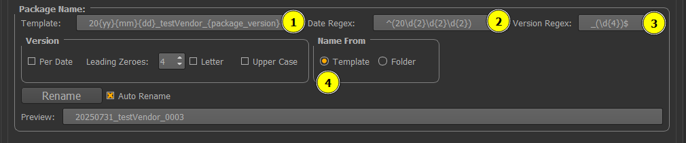

Assists with adhering to naming convention. Typically, coordinator gathers all the files to be sent in one folder with temp name, for example: {show}/out/submissions/temp\_name

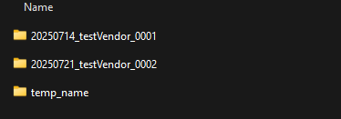

SH checks the folders next to the package (in {show}/out/submissions) and detects previous sendings. With Name From set to Template, Preview shows the next package name. The package folder is renamed to it when you press **Rename**, or after Go when **Auto Rename** is on.

* **Template** builds the new name. It can only use the date tokens `{yy}` `{y}` `{mm}` `{m}` `{dd}` `{d}` and `{package_version}`, which is replaced by the next available version.  
* **Date Regex** finds the date stamp: its first capture group, or the whole match when it has no group. It is run on the expanded template (to get today's stamp) and on every folder next to the package. The date tokens are expanded, so `sub_{yy}{mm}{dd}` finds the packages of today; `sub_(\d{6})` finds any date.  
* **Version Regex** finds the version in the folders next to the package; its first capture group is the version, e.g. `_(\d{3})$` for numbers or `_([A-Z])$` for letters. Numbers compare by value (`010` is after `009`).  
* **Per Date** restarts the versions every day; only folders with today's date are compared. With it off, versions continue across dates.  
* **Leading Zeroes**, **Letter** and **Upper Case** set how the version is written.

Some productions want to simply number the sendings from one up, but include the date in the name (the example shown). Editorial sometimes prefers to send packages that are versioned per date:

* 20251224\_0001  
* 20251224\_0002  
* 20251225\_0001

Or per date with letter (Letter on, Version Regex capturing one letter, e.g. `_([A-Z])$`):

* 20251224\_A  
* 20251224\_B  
* 20251225\_A

The name is available as `{package_name}`, the date as `{package_date}` (only with Per Date on), and the version as `{package_version}`.

## Submission File Age

**Only Last** keeps only recently written files in the Submission spreadsheet: files older than the set age (minutes, hours or days, by modified or created time) are hidden from the Submission. The Drive Log and Text keep them. A file sequence is as old as its newest frame. **Age Include** limits the age filter to paths that contain one of its words, **Age Exclude** lists words of paths that are never hidden by age (both separated by spaces). Note that *created* is the creation time only on Windows.

# Parsing Tab

Parsing Tab allows you to define custom, per file tokens. Those tokens can be derived from file name or path, or from file metadata.

An easy way to learn what metadata is available is to use Inspector Tab.

For every file (or file sequence) SH detects, it first scans for metadata, and then processes the Parsing Tab from top to bottom (48 rows). Note that you can use the tokens defined in upper lines in lower lines, defining other tokens. For tokens with the same name, lower lines overwrite upper lines.

There are five columns in the parsing tab:

1. Name: The name of newly created token  
2. Pattern: Regular expression to define the pattern  
3. Repl: Replace expression. If empty, first matching group is used as an output  
4. Source: The source string for the Pattern search (can use tokens). If it uses a token that the file doesn't have, the result is empty.  
5. Filter: Only process the line for files whose full path contains the Filter text (plain text, case sensitive). Empty means all files.

A row is skipped when Name, Pattern or Source is empty. With Repl set, a Source that doesn't match the Pattern is used unchanged, so anchor such patterns with `^` and `$`.

Useful Source tokens: `{name}` is the file name without extension, `{part1}` the file name with extension, `{part2}` the parent folder, `{part3}` the folder above it, and so on.

Tokens from the Data, ftrack and Ayon tabs are added after parsing, so don't use them in Source.

## Example: Parsing Shot Name

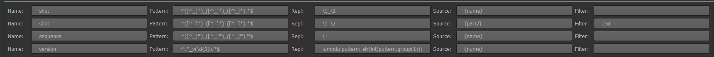

Let’s say your naming convention adheres to {seq}\_{shot}\_{task}\_v{version}  
Your package contains files like  
{package\_root}/001\_0010\_comp\_v001.mov  
{package\_root}/001\_0010\_comp\_v001/001\_0010\_comp\_v001.1001.exr

First line uses file name (001\_0010\_comp\_v001.mov, 001\_0010\_comp\_v001.1001.exr) with pattern ^(\[^\_\]\*)\_(\[^\_\]\*)\_(\[^\_\]\*).\*$ and Repl string outputs first two groups \- pattern parentheses separated by underscore: \\1\_\\2. This defines the short name for both files as 001\_0010.

The second line uses {part2} token as a source, which is one folder up from the detected file name. File sequences typically have a per sequence folder. This line forces SH to use the name not from the file name, but from its parent folder, with a filter to only do this for EXR files.  
{package\_root}/001\_0010\_comp\_v001/001\_0010\_comp\_v001.1001.exr  
This shows how to overwrite the shot token for specific file formats.

The third line is very similar to the first line, but only outputs the part of the file name before the first underscore as a sequence name.

The fourth line shows that Repl string can be also a Python code starting with lambda, for example `lambda m: m.group(1).upper()`. This might be necessary for string manipulations not possible with bare regular expressions, like uppercase / lowercase, or calculations.

# Convert Tab

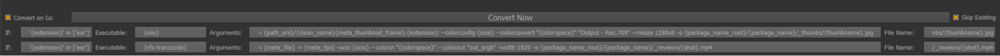

Convert Tab allows you to run one or more external processes per file.

The Convert on Go checkbox makes SH run the commands when the Go button is pressed, before the spreadsheets are written. Convert Now runs them right away. The commands run one after another and the window waits until all are done.

The Skip Existing checkbox evaluates the expected output file name for each convert first, and only executes the process if the file doesn’t exist. One package can often include a bunch of outputs from the same shot/asset version \- exr sequence, mp4 preview, DNxHD mov for editorial… This option allows you to skip unnecessary processing. For example, if you define first convert to use mov file for converting to thumbnail with the name of the shot and version, and second line to do the same from EXR files, the thumbnail from EXRs processing will be skipped if the thumbnail from mov output already exists.

There are four columns in the convert tab line:

1. If: Python expression, only run the process if true. Empty means all files.  
2. Executable: The executable used.  
3. Arguments: The command line  
4. File Name: Expected output. Required: a row without File Name is not run. Used for Skip Existing, and available in spreadsheets as `{convert_path01}` and `{convert_path_relative01}` (01 is the first row with Arguments and File Name filled, 02 the next one…).

These tokens give the tools SH found, from `PATH`, the `SH_FFMPEG` / `SH_FFPROBE` / `SH_OIIOTOOL` environment variables or install.json:

| Token | Tool |
|---|---|
| `{ffmpeg}` | ffmpeg |
| `{ffprobe}` | ffprobe |
| `{oiio}` | oiiotool |
| `{vfx-transcode}` | vfx-transcode (install.json only) |
| `{ocio}` | OCIO config file: Preferences Custom OCIO, install.json, or the `OCIO` environment variable |

A plain `ffmpeg` without braces is looked up on the system PATH instead. Tool paths are inserted without quotes, so avoid spaces in them; quote file paths in Arguments yourself, e.g. `"{path}"`. For ffmpeg, add `-y` so it doesn't stop to ask before overwriting.

## Example: Creating Thumbnails from EXR files

The if condition '{extension}' in \['exr'\] makes sure only exr files are processed.  
The {oiio} executable is defined by SH installation, you can use the full path here if preferred.

Command line arguments:

\-i {path\_prs}/{clean\_name}{meta\_thumbnail\_frame}.{extension}  
The {meta\_thumbnail\_frame} token is prepared during file scan, it is the middle frame of file sequence. For ffmpeg, there is a {meta\_thumbnail\_time} token for the middle of the container file.

\--colorconfig {ocio}  
The {ocio} token is determined by SH installation or preferences.

\--colorconvert "{colorspace}" "Output \- Rec.709"  
The {colorspace} token is set by Parsing Tab, for example “ACES \- ACES2065-1” for EXRs.

\--resize 1280x0  
Resize to the width of 1280 pixels, keep aspect ratio

\-o {package\_name\_root}/{package\_name}/\_thumbs/{thumbname}.jpg  
The {thumbname} token is set by Parsing Tab

File name is a copy of the output argument above:  
{package\_name\_root}/{package\_name}/\_thumbs/{thumbname}.jpg

# Sidecar Tab

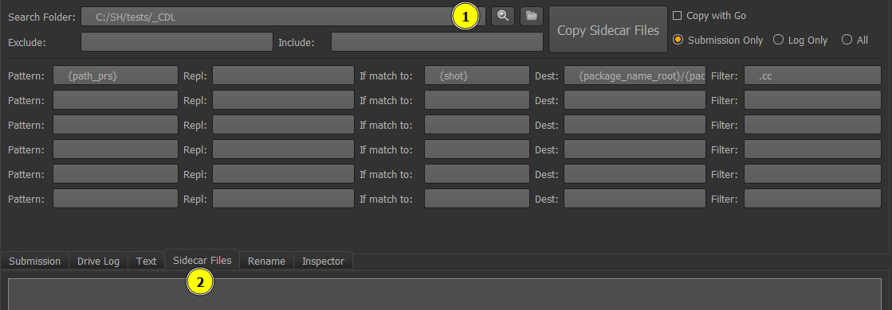

Can be used to copy additional files from your project to the package. For example, some productions deliver per shot CDL files to vfx vendors, and require to forward the CDLs to the finishing vendor together with finals.

The Search Folder (1) is the path where to search for files, including subfolders. Exclude skips files whose full path contains any of the words (separated by spaces). Include accepts only files whose full path contains one of the words, e.g. `.cdl .cc`.

The Submission Only / Log Only / All options consider only package files listed in the Submission table, in the Drive Log table, or all files.

There are five columns in the sidecar tab line:

1. Pattern: Regex pattern applied to the found file name (without folder). With Repl empty, its first capture group is the result.  
2. Repl: Optional replace pattern applied to the found file name.  
3. If match to: Tokens of the package file, e.g. `{shot}`. The sidecar file is linked to every package file where this equals the result exactly.  
4. Dest: Path to where to copy (and maybe rename) the sidecar file. Include the file name, e.g. `{package_name_root}/{package_name}/cdl/{sidecar_file}`. Sidecar tokens: `{sidecar_path}`, `{sidecar_file}`, `{sidecar_ext}`, `{sidecar_result}`; tokens of the package file work too.  
5. Filter: Only consider found files that have this string in file name (plain text, case sensitive).

## The process

Find all sidecar files that match the Search folder, Exclude and Include conditions.  
For every package file, for every sidecar file, for every sidecar line, find the destination. For all matching sidecar files, list the source and destination in the bottom Sidecar Tab (2).  
Copy Sidecar Files (or Go with Copy with Go on) copies the listed files. Missing folders are created and existing files are overwritten.

# Rename Tab
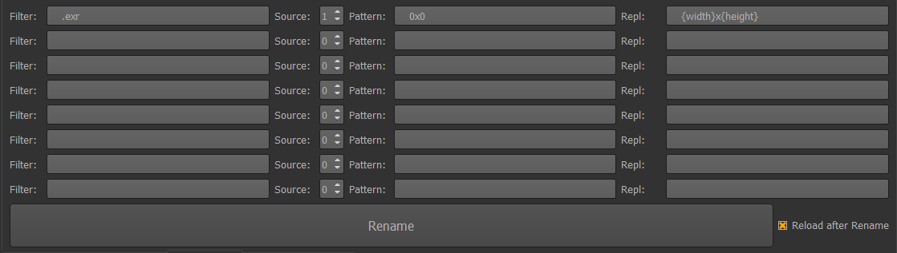

Can be used for renaming the files by client requirements. For example, some productions require a resolution folder in the form {width}x{height} in the path of delivered file sequences.

Your temp\_folder has {package}/{shot}\_{task}\_v{version}/0x0/{shot}\_{task}\_v{version}.1001.exr

The Rename tab allows you to rename the universal 0x0 folder by the EXR metadata to {width}x{height}: Source `2`, Pattern `^0x0$`, Repl `{width}x{height}`.

There are four columns in the rename tab line:

1. Filter: Python expression; the line is used only for files where it is true, e.g. `'{extension}' == 'exr'`. Empty means all files.  
2. Source: Which part of the path to rename: 0 is the whole path, 1 the file name, 2 the folder of the file, 3 the folder above it… Extension and frame number are never renamed.  
3. Pattern: Regex to check (tokens allowed)  
4. Repl: Replace string (tokens allowed). A line with an empty Repl is off.

Lines are applied in order; each line works on the result of the line above. The bottom Rename tab shows the planned renames, as full paths, paths relative to the package or file names only. **Rename** renames and moves the files right away, with no undo; files whose destination exists are skipped. With **Reload after Rename** on, the package is read again afterwards, otherwise press Reload. Emptied folders stay behind.

# Data Tab
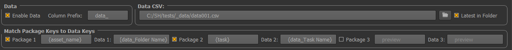

Sometimes the tokens parsed from file name or metadata are not enough for producing the outputs or checks required. Data Tab allows you to load arbitrary data from a CSV file, and pair it to the files detected by SH.

Data CSV field points to the CSV file to be used. If the Latest in Folder option is checked, SH searches in the folder path, sorts all the CSV files by name, and loads the “latest” csv file. For example, if data002.csv and data002b.csv exist in C:/SH/tests/\_data/, SH will load the data002b.csv. This allows coordinators to add updated csv data files to the folder, instead of overwriting. The {csv\_data\_file} token is filled with the file name actually used.

## The Match Package Keys to Data Keys group

For each file detected by SH, a row from Data CSV can be paired. You can use one to three conditions (Package1, Package2, Package3) and check if the value from the Data CSV column labeled Data N is equal to the string in PackageN. All conditions that are on must match; the comparison is exact and case sensitive. For Shot lists, this typically requires matching shot name or shot & task name. Paired rows are green in the table.

## Column Prefix

There can be arbitrary column names in the Data CSV. To avoid overwriting the tokens already parsed from the file name, metadata, or other sources, the prefix will be added to every token loaded and paired to the file: with the prefix `data_`, the column `shot` becomes `{data_shot}`. Please add the Column prefix also to the matching data keys.

Changes to the CSV, the Column Prefix and the match conditions apply right away; tokens of the previous match are removed.

# Ftrack Tab

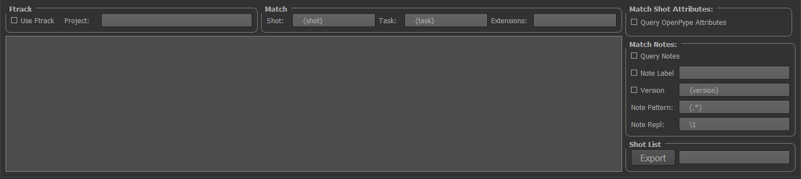

Sometimes the tokens parsed from file name or metadata are not enough for producing the outputs or checks required. Ftrack Tab allows you to load data from a Ftrack and pair it to the files detected by SH. Server, user and API key come from install.json.

Note: querying Ftrack is slow, every change in the tab queries ftrack again. Consider setting up the rest of SH with Use Ftrack checkbox off first.

For every file detected by SH, query the Ftrack project (its full name, active projects only) with the Shot and Task fields, which are filled per file (default `{shot}` and `{task}`). **Extensions** limits the files that get notes, e.g. `exr, mov`; empty means all files.

The table on the tab has one row per file: what was looked up, a Status (`ok`, `task not found`, `version not found`, `template not resolved`, `skipped (extension)`…), the number of notes and the selected note.

## Query OpenPype Attributes

For each matching shot and task, also query Ftrack hierarchical attributes (frame range, handles) used by OpenPype. They become `{ftrack_op_frame_start}`, `{ftrack_op_frame_end}`, `{ftrack_op_range}`, `{ftrack_op_length}` and similar tokens.

`{ftrack_op_start}`, `{ftrack_op_end}`, `{ftrack_op_range}` and `{ftrack_op_length}` include the handles. The `_slate` versions (`{ftrack_op_start_slate}`, `{ftrack_op_range_slate}`, `{ftrack_op_length_slate}`) add one slate frame before the first frame: with frames 1001-1100 and handles 8, `{ftrack_op_range}` is `993-1108` (116 frames) and `{ftrack_op_range_slate}` is `992-1108` (117 frames).

## Match Notes

If Query Notes is on, for each matching shot and task find Notes. With **Version** on, the notes of that version of the task are used instead. **Note Label** keeps only notes with that ftrack label. **Note Pattern** is a regex that picks the notes, and **Note Repl** builds the text from it (e.g. `\2`); with Note Repl empty, every note containing a match is used whole. The result is `{ftrack_note}`; several notes are joined with `;---;`.

## Shot List

**Export** writes the ftrack shot list to the path next to it: a .csv file, or a folder (ftrack\_shotlist.csv is written in it). Empty means the package folder. It is the same as the command line action `x`.

# Vendor Tab

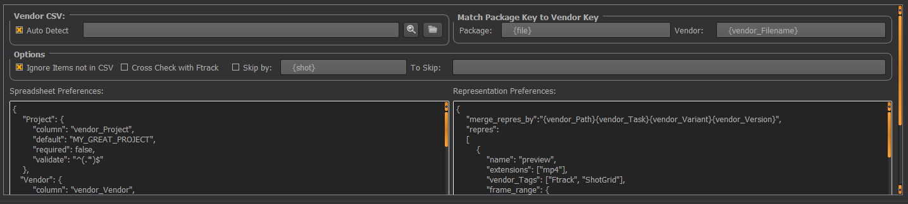

This rather cryptic name is used to check and modify packages received by the studio.  
It expects a package folder with csv spreadsheet listing the files to be ingested.

## Vendor CSV

The file to be used for ingest. With **Auto Detect** on, drop (or browse to) the vendor's CSV file instead of the folder: the CSV becomes the Vendor CSV and its folder becomes the package folder. The same works on the command line with `-i path/to/delivery.csv`.

Loading a preset in the GUI keeps the current Vendor CSV.

**Package** and **Vendor** keys pair the package files with the CSV rows. Both are text with tokens (not regexes): a file and a row are paired when the Package key of the file equals the Vendor key of the row, e.g. Package `{name}` and Vendor `{vendor_Filename}`.

**Ignore Items not in CSV** leaves files that are not listed in the CSV out of the Submission. **Skip by** / **To Skip** additionally leave out files whose Skip by value (e.g. `{shot}`) is one of the space separated values in To Skip.

## Spreadsheet Preferences

Json text to add tokens by Vendor CSV column name. Every item allows for default value, regex to check if value supplied by vendor is valid, and if column name presence is required in the Vendor CSV file. Every item needs all four keys.

### Example Spreadsheet Preferences Item

"Project": {  
"column": "vendor\_Project",  
"default": "MY\_GREAT\_PROJECT",  
"required": false,  
"validate": "^(.\*)$"}  
A column named Project (token name {vendor\_Project} to avoid conflicts) is not required, and will have the default value MY\_GREAT\_PROJECT if not found in the vendor csv file. The validation regex ^(.\*)$ will be always true, effectively allowing any string as a project name.

Spreadsheet preferences serve multiple purposes:

* Check if required column name is present in vendor csv  
* Check if column value format matches validation regex (ie enforce naming convention)  
* Can add default values.

Columns not listed are available as `{vendor_<Column>}`. The representation checks below need the columns that become `{vendor_Output}`, `{vendor_Task}` and `{vendor_Intent}`.

## Representation Preferences

One package can often include a bunch of representations from the same shot/asset version \- EXR sequence, mp4 preview, DNxHD mov for editorial, Nuke Script workfile…

The purpose of Representation preferences Json is to define and check representations relationships. Problems are reported in `{vendor_row_errors}`.

### merge\_repres\_by

"merge\_repres\_by":"{vendor\_Path}{vendor\_Task}{vendor\_Variant}{vendor\_Version}"

Defines how to group lines (different representations) from vendor csv file to one shot/asset. The example above puts together Path, Task, Variant and Version column values to define the key for every vendor csv line. Lines are considered merged if the key from different lines matches.

### repres

A list of  representations, where each representations has:

{  
"name": "preview",  
"extensions": \["mp4"\],  
"vendor\_Tags": \["Ftrack", "ShotGrid"\],  
"frame\_range": {"frame\_rate": "{meta\_fps}", "length": "{meta\_duration\_frames}"},  
"metadata\_check": { "meta\_codec\_name\_video": "h264", "meta\_fps": "25", "meta\_width": "1332","meta\_height": "720"}  
},

name: How to name the representation; compared with the row's `{vendor_Output}`  
extensions: list of file extensions allowed for the representation, without dot, case sensitive  
vendor\_Tags: Special column to indicate if to send the representation to Ftrack, …  
frame\_range: define frame\_rate and length by file tokens  
metadata\_check: tokens and their expected values

### task\_intent\_repres

Often more than one representation is required to be present in the package. This part of the representation preferences Json tries to validate if expected representations are present.

Each task name, paired with intent (status implied by vendor) can have different requirements.  
For example, for compositing task with WIP intent, only preview mp4 is required. For compositing tasks with QC or PAF intent, the EXR representation is required as well.

"compositing": \[{  
"intents": \["WIP", "wip", "CHECK", "check", "TEST", "test", "Test"\],  
"always": \["preview"\],  
"optional": \["exr", "nk"\]  
},  
{  
"intents": \["PAF", "paf", "QC", "qc","FINAL", "final"\],  
"always": \["exr", "preview", "nk"\],  
"optional": \[\]  
}  
\],

# Replace Tab

Meant to modify text files by searching and replacing the strings. Typically, this is used to modify the file paths when sending workfiles like Nuke scripts or Maya ascii files from one studio to another.  
Expects a CSV file that defines the search and replace strings, with the columns `Extension,Pattern,Search,Replace`, one rule per row:

```
Extension,Pattern,Search,Replace
nk,,D:/projects/,/mnt/projects/
```

The last CSV file (by name) in the folder of the given file is used. A rule applies to a file when:

- **Extension** (without dot) equals the file extension. Case doesn't matter: `nk` matches `.nk` and `.NK`.
- **Pattern** is empty, or the file name contains it. Pattern is literal text (no regex, no wildcards) and case-sensitive. For example `_comp_` limits the rule to files like `sh010_comp_v003.nk`.

**Search** and **Replace** are literal text too. Rules with an empty Search are skipped. When several rules apply to a file, they run in CSV order, each on the result of the previous one.

The table shows which files the rules apply to. **Replace** applies the rules now; **Replace with Go** applies them as the first step of Go. On the command line it is the action `e`. Enable must be on in all cases. The CSV is read again each time, so changes to it are picked up.

The files are changed **in place, without a backup**: run it on a copy of the delivery, never on the only original. Text is read as UTF-8 (other files as latin-1) and written back with the same encoding and line endings.

Running the replace twice applies the rules twice. That is harmless when the Replace text doesn't contain the Search text (`D:/projects/` → `/mnt/projects/`), but a rule like `a` → `ab` grows with every run. Nothing remembers which files were already replaced, so don't press Replace and then also use Replace with Go on the same files.

# Spreadsheet Tab

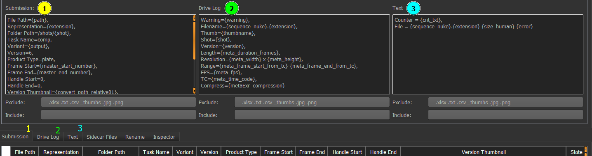

Defines column names and their value for every file detected by SH. There are three main spreadsheet outputs in SH, for historical reasons named Submission (1), Drive Log (2), and Text (3).  
For each spreadsheet, you can specify space separated strings that are skipped (Exclude) or required (Include) in the full file paths. This is often used to ignore file types by extension, e.g. Exclude `.mov`.

The syntax is comma separated \<column title\>=\<column value\>, for example:

```
Shot={shot},
Frames={range},
Size={size_human},
Vendor=MyStudio,
```

* Put a comma after every column, also at the end of a line: a line break alone doesn't separate columns.  
* A value can't contain a comma or `=`.  
* The value is text with tokens. Format specs work, e.g. `{cnt_sub:0>4}`.  
* Spaces around `=` become part of the title (`Shot = {shot}` gives the title "Shot "); write `Shot={shot}` when you use the title in Exports Skip / Split.

Counters and totals for each output: `{cnt_sub}` `{cnt_log}` `{cnt_txt}` number the rows (start, step and digits are set in Preferences); `{total_sub}` … is the number of rows (a sequence counts once), `{files_sub}` … the number of files (every frame counts), and `{total_size_sub_human}` … the total size.

# Grouping Tab

Often more than one file of the same version goes to the client: the exr sequence, an mp4 review, a thumbnail. Grouping puts those files together, checks that the group has the representations the client needs, and shows the groups in the Submission and Drive Log tables. It replaces Merge By (formerly on the Preferences tab).

* **Enable Grouping** switches the tab on. Off, nothing below has any effect.  
* **Group by** is a token template; files with the same result are one group, e.g. `{folder_name}{task_name}{variant}{version}` or `{shot}{task}{version}`. A file where a token is unknown is in no group.  
* **Representation** is the representation name of each file, compared (not case sensitive, without a leading dot) with the Repres fields of the definitions. Default `{extension}`; with the Ayon tab matching versions, `{list_Matched Representation}` uses the Ayon representation.  
* **Task Type** and **Task Name** give the task of each file, compared with the definitions.  
* **Do not export items in group with missing Representations**: groups that miss a required representation are left out of the Submission export (Excel, CSV and so the Ayon publish CSV). They stay in the Submission table, in red, and the Drive Log is exported in full.  
* **Keep Group Rows Together** lists the rows of a group one below the other, at the place of its first row.  
* **Color Group Rows** gives the rows of each group the same muted background in the Submission and Drive Log tables. Error, warning and size warning colors win. **Color Rows in Excel** colors the Excel exports too (groups light, errors red, warnings orange); it is off by default because the Submission usually goes to the client.  
* **Collapse Groups** shows each group as one row in the Submission and/or Drive Log. In every column equal values are shown once and different values are joined by **Separator**, e.g. `exr, mp4`. A collapsed row is red or orange when any of its files is.

## Group Definitions

**Add Group Definition** adds one at the end. For every group, the definitions are tried from the top (▲ ▼ change the order) and the first enabled one whose **Task Type(s)** and **Task Name(s)** match a file of the group is used. Both accept several values separated by commas or spaces, wildcards `*` `?`, and match anything when empty. A group without a matching definition is still grouped, colored and collapsed, but not checked.

* **Always Repres**: required, must be in the package, e.g. `exr`.  
* **Always/Convert Repres**: required, in the package or made by a Convert row from a file of the group (the extension of the Convert File Name counts), e.g. `mp4`.  
* **Optional Repres**: may be in the group.  
* A missing required representation is an error on every row of the group. A required representation with an error from the Checks tab makes the other rows of the group red too. When any Repres field is filled in, a file with a representation not listed gets a warning, and so does a representation that is in the group more than once.  
* **Inherit Columns**: Submission column titles, separated by commas. In each group, a cell that is empty or still has an unknown `{token}` takes the value of the same column from another file of the group: the first one in **Inheritance Repre Priority** order (e.g. `exr mp4`) with a good value, then the others in table order.  
* **Review Repre** / **Thumbnail Source Repre**: every file of the group gets the tokens of that file as `{group_review_<token>}` / `{group_thumb_<token>}`. For example with Thumbnail Source Repre `exr`, `{group_thumb_convert_path01}` is the thumbnail Convert row 01 made from the exr, also on the mp4 row; with Review Repre `mp4 mov`, `{group_review_full_path}` is the review movie.

Group tokens of every file (empty when it is in no group): `{group_key}`, `{group_name}` (definition name), `{group_number}`, `{group_size}`, `{group_repre}` (its representation), `{group_repres}` (all in the group), `{group_missing}`, `{group_to_convert}` (required representations a Convert row will make), `{group_error}`, `{group_warning}`. The group errors and warnings are also part of `{error}` and `{warning}`.

# Checks Tab

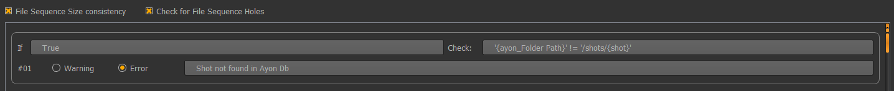

You can set up arbitrary checks that will fill the {warning} or {error} token for the file. Non-empty warning token will color the corresponding Spreadsheet lines orange, non-empty error token will color the line red. Both tokens can be used as spreadsheet columns.

Each of the 21 check rows has:

* **If**: optional Python expression; the check runs only on files where it is true. Empty means all files.  
* **Check**: Python expression; when true, the message is added to the file. An empty Check turns the row off.  
* **Warning** / **Error**: whether the message goes to `{warning}` or `{error}`.  
* **Message**: the text to add, tokens allowed. Empty gives "Error check NN" / "Warning check NN".

Examples: If `'{extension}' == 'exr'`, Check `{meta_width} != 4096`; or Check `'{meta_fps}' != '24'`. An expression that fails (a typo, a missing token) counts as false, so a check with a mistake never fires; test new checks on a file that should fail.

## File Sequence Size Consistency

If on, SH checks the size of every file in the detected file sequence. For every file, it checks the Neighborhood frame sizes and warns if the file size differs too much. Check the Preferences Tab for tuning this. There is an option for skipping first frames (useful when using slates). Note that this check can be considered fool proof only with uncompressed file sequences, where you can safely expect consistent file sizes.

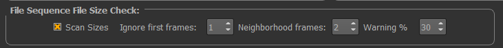

## Check for File Sequence Holes

If on, missing frames in file sequences are reported as a warning (orange). The bottom Files tab lists the missing frame numbers.

Both size checks need **Scan Sizes** on in Preferences.

# Ayon Publish Tab

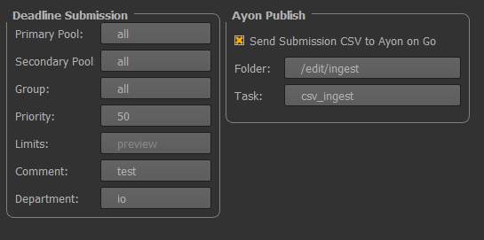

Settings for the **Publish Ayon Local** and **Publish Ayon Deadline** buttons. Both write the Submission spreadsheet as CSV (Exports > Submission > CSV must be on; with Split Column on, every split file is published) and ingest it with Ayon's tray publisher CSV ingest:

* **Folder** and **Task** (this tab) and **Project** (Ayon tab) are required.  
* **Publish Ayon Local** runs the ingest on this computer; the window waits until it finishes.  
* **Publish Ayon Deadline** submits the ingest as a Deadline job with **Primary Pool**, **Group**, **Priority**, **Department** and **Limits** from this tab.

**Secondary Pool** and **Comment** are added to the Deadline job when they are filled. With **Send Submission CSV to Ayon on Go** on, Go also runs the local publish after the exports.

The ayon (and for Deadline the deadlinecommand) executable and the Ayon / ftrack connection come from install.json. The buttons do nothing when no package is loaded.

# Ayon Tab

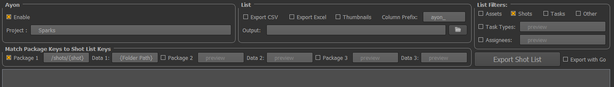

Sometimes the tokens parsed from file name or metadata are not enough for producing the outputs or checks required. Ayon Tab reads the folders (shots, assets) and tasks of an Ayon project and pairs them to the files detected by SH.

* **Enable** reads the list whenever the package is loaded or reloaded. **Scan** reads it right away, also without a package and with Enable off.  
* **Match Package Keys to Shot List Keys** works like the Data tab: Package N (file tokens, e.g. `{shot}`) must equal Data N (shot list columns, e.g. `{Folder Name}`). Matched rows are green, and their columns become tokens with the **Column Prefix**, e.g. `{list_Folder Name}`, `{list_Range}`, `{list_Task Status}` with the prefix `list_`.  
* **List Filters** limit the rows shown: Assets / Shots / Other pick folder rows, Tasks adds task rows, Task Types / Task Names / Assignees narrow the tasks, Matched Only keeps rows matched to package files.  
* **Export Shot List** writes the rows shown to **Output**: `ayon-list.csv` with **Export CSV**, `ayon-list.xlsx` with **Export Excel** (with both off, the csv), and with **Versions CSV** also `ayon-list-versions.csv`. **Export with Go** also exports it when Go is pressed. **Thumbnails** downloads folder and task thumbnails to Output/\_thumbsDownload when the list is read.  
* **Versions**: with **Pull versions** and **Product filters** (e.g. `comp:renderCompMain:exr, :platePl01:exr`), every row gets the latest version of the preferred product. The **Matched Versions** sub-tab lists the versions of the matched folders, and **Match version** pairs each file with its version, e.g. Package `{version}` with Version `{Version}`. Each file is also paired with a representation of that version, by file extension first, then by file size (`{list_Matched Representation}`). **Record Package to Ayon** (or **Record Package with Go**) writes the package name into the data of those versions (with the representations in the package) and representations.

Changes to the match rules and the Column Prefix apply right away. Project, Enable and Thumbnails take effect on the next Scan or Reload, because they need a new Ayon query. The README has the full description of the version columns and filters.

# Preferences Tab

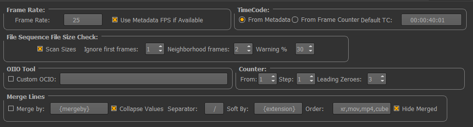

* **Frame Rate** is used for `{meta_fps}` when **Use Metadata FPS if Available** is off. It accepts `24`, `23.976` or `24000/1001`. Press Reload after changing it.  
* **Scan Sizes** reads the file sizes (`{size_bytes}`, `{size_human}`) and checks sequences for empty, missing and inconsistent frames. **Ignore first frames** skips slates, **Neighborhood frames** is how many frames on each side each frame is compared to, and **Warning %** is how much its size may differ from their average.  
* **TimeCode**: `{meta_time_code}` comes **From Metadata** (falling back to the frame counter for sequences) or **From Frame Counter** (the frame number of a sequence and its fps). Videos and sequences with no timecode get **Default TC**; leave it empty for no timecode. Press Reload after changing them.  
* **Custom OCIO** sets the OCIO config used as `{ocio}` in Convert commands, instead of the one from install.json or the OCIO environment variable. Press Reload after changing it.  
* **Accounts**: who is signed in to ftrack and Ayon, and where the credentials come from (environment, Windows Credential Manager or install.json). **Sign in...** asks for your own account: ftrack through the web browser (or your personal API key), Ayon with user name and password. **Sign out** removes the stored credentials from this computer. The first time ftrack or Ayon is used without credentials, SH asks by itself.  
* **Counter**: start, step and digits of `{cnt_sub}`, `{cnt_log}` and `{cnt_txt}`.  

# Exports Tab

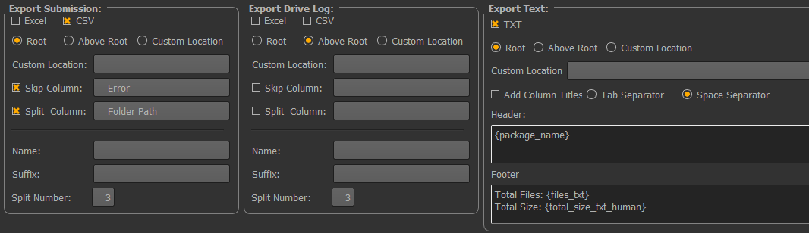

This tab controls if spreadsheets are exported, and to what path, name and file format. Files are written when Go is pressed.

* **Excel** / **CSV**: the formats to write. CSV is UTF-8; the Publish Ayon buttons need the Submission CSV.  
* **Root** saves into the package folder, **Above Root** next to it (in its parent folder), **Custom Location** into the given folder, which must exist. Files saved into the package folder show up in the package after the next Reload; use Above Root or an Exclude rule to avoid that.  
* **Name** is the file name without extension; empty means the package name. **Suffix** is added after it.  
* **Skip Column** leaves out rows that have any text in the named column. **Split Column** writes one file per value of the named column; the files are numbered (`name001.csv`, `name002.csv`…, digits set by Split Number). The column title must be written exactly as on the Spreadsheet tab.  
* **Export Text**: **TXT** writes the Text preview to `{package_name}.txt`. **Header** and **Footer** are placed above and below the rows and can use package tokens such as `{package_name}`, `{total_txt}` or `{total_size_txt_human}`; write `{{` and `}}` for literal braces. **Add Column Titles** adds a title line, and the columns are separated by a tab or by one space.

# Presets Tab

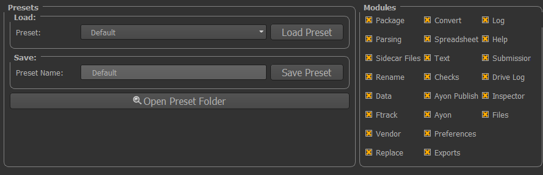

Allows to store and load the gui values for SH. Modules group can be used to hide the tabs not required for a particular preset. Hiding a tab doesn't switch its features off: for example a hidden Convert tab still converts on Go.

The path to store preset Json files can be set up to network location for studio wide use.  
Danger: if you press Save Preset and Preset name matches an already existing one, the preset will be overwritten with no further warning.

Loading a preset keeps the current Package Folder and Vendor CSV; a loaded package is read again with the new preset.

SH automatically saves the current state to the last\_\<username\> preset, so users can easily return to the last preset with no need to explicitly load it via the Load Preset button.

# Bottom Tabs

* **Submission**, **Drive Log**, **Text**: previews of the exports. Red rows have an error, orange rows a warning. Edits made in the tables are not exported; the column widths are used for the Excel export.  
* **Sidecar Files**: the sidecar files to copy.  
* **Rename**: the planned renames.  
* **Inspector**: every token of every file.  
* **Files**: the files found, with size, category and missing frames.

# Not working yet

These controls are in the window but don't work yet. Their tooltips say "Not implemented yet".

| Tab | Control | Status |
|---|---|---|
| Replace | Replace, Replace with Go | Not implemented: the tab only previews the rules. |
| Vendor | Cross Check with Ftrack | Not implemented. |
| Ayon Publish | Product, Version, Check if Version Exists, Change Version to Available | Not implemented. |
