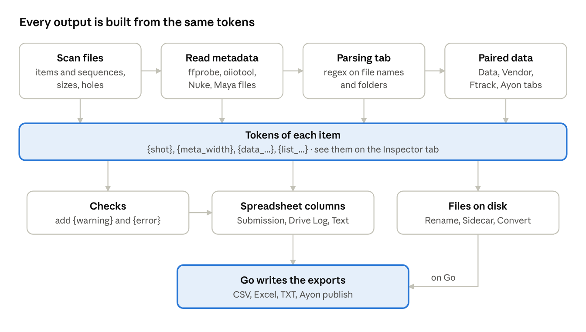

# Submission Helper – User Guide

Last updated: 2026-10-16

## Introduction

Submission Helper (SH) turns a folder of files into a clean, checked delivery: a correctly named package folder, one or two spreadsheets that describe every file, and a text summary for the follow-up email. It works in both directions – packages your studio sends to a client, and packages a vendor sends to you for ingest into Ayon.

There is no industry standard for how a delivery spreadsheet should look, so SH does not impose one. Instead it gives you building blocks – tokens, parsing rules, data sources, column templates and checks – that you combine into a **preset** for each client or vendor. Once a preset exists, a package is usually done in three steps: drop the folder, look at the tables, press **Go**.

**Typical jobs**

- Check that outgoing files match the client's spec: resolution, frame rate, codec, naming, missing or empty frames.
- Produce the client's submission spreadsheet in exactly their column layout, with notes, status and versions pulled from ftrack or Ayon.
- Name the package folder by the delivery convention, with per-day or running version numbers.
- Make a thumbnail per shot, collect per-shot CDLs or LUTs, rename files to the client's naming.
- Check a vendor's delivery against its CSV, and publish it to Ayon locally or on Deadline.
- Record in Ayon which versions went out in which package.

**What SH reads**

| Source | What it gives | Where it is set up |
| --- | --- | --- |
| File system | Names, paths, sizes, sequences, missing frames | Package tab, Preferences |
| ffprobe / oiiotool | Resolution, fps, codec, timecode, audio, colour metadata | Preferences (frame rate, timecode) |
| Nuke scripts, Maya ascii | Format, frame range, fps, OCIO, references | automatic |
| Your own CSV | Any extra columns, paired to files | Data tab |
| Vendor CSV | The vendor's list of delivered files | Vendor tab |
| ftrack | Notes, frame range, handles, shot list | Ftrack tab |
| Ayon | Shot list, tasks, versions, representations | Ayon tab |

Every control in the window has a tooltip. This guide explains how the controls work together; hover over a control when you only need a reminder.

## Concepts

SH reads every file in one folder, turns each file into a set of named values called **tokens**, and fills spreadsheet columns, checks and file names from those tokens. Everything else is a way to add tokens or to use them.

### Package and items

The **package folder** is the folder you drop on the window. SH scans it with all subfolders. Each **item** is one file, or one whole file sequence (`shot.1001.exr` … `shot.1100.exr` is one item). Each item gets a **category** by its extension: `still`, `sequence`, `video`, `audio`, `multiframe` or `other`.

The package folder's parent matters too: SH looks at the folders next to the package to work out the next package version (Package tab).

### Tokens

A token is a name in braces, such as `{shot}` or `{meta_width}`, replaced by the value of each item. Almost every text field accepts tokens. Tokens come from, in this order:

1. The file itself – name, path, sequence range, size (`{name}`, `{range}`, `{size_human}`).
2. File metadata – ffprobe, oiiotool, Nuke and Maya parsing (`{meta_fps}`, `{meta_nk_width}`).
3. The **Parsing** tab – your own tokens cut out of names and paths with regex (`{shot}`, `{task}`).
4. The **Data**, **Vendor**, **Ftrack** and **Ayon** tabs – values paired from outside sources, each with its own prefix (`{data_…}`, `{vendor_…}`, `{ftrack_…}`, `{list_…}`).
5. **Checks** – `{warning}` and `{error}`.

Open the **Inspector** tab at the bottom to see every token of every item with its value. It is the fastest way to find the right token name.

Rules that hold almost everywhere:

- An unknown token stays in the text as it is: `{shoot}` stays `{shoot}`, so typos are easy to spot in the tables.
- Python format specs work: `{cnt_sub:0>4}` gives `0001`.
- Only token names in braces are replaced, so regex counts like `\d{3}` keep working in fields that are a regex and also take tokens.
- Fields named **If**, **Filter** (Rename tab) and **Check** are Python expressions. Tokens are pasted in as plain text, so quote text values: `'{extension}' == 'exr'`. Numbers need no quotes: `{meta_width} > 1920`. An expression that fails counts as false.
- Fields named **Repl** accept `lambda m: …` for Python on the regex match, e.g. `lambda m: m.group(1).upper()`.

### The three outputs

SH writes up to three exports when you press **Go**. The names are historical; use them for whatever your delivery needs.

| Output | Usually holds | Formats | Notes |
| --- | --- | --- | --- |
| **Submission** | What the client ingests: one row per shot or file, with their columns | CSV, Excel | Can be filtered by file age and vendor CSV, grouped and collapsed (Grouping tab). Used by Ayon publish. |
| **Drive Log** | A record of everything that was sent | CSV, Excel | Never age-filtered; collapsed only when Grouping says so. |
| **Text** | Lines for the follow-up email | TXT | Header and footer around the rows. |

Each output has its own column template (Spreadsheet tab), its own Include / Exclude path filters, and its own counters (`{cnt_sub}`, `{cnt_log}`, `{cnt_txt}`). The bottom tabs preview each output exactly as it will be written. Red rows have an `{error}`, orange rows a `{warning}`.

### How a package is processed



Each step adds tokens to every item, left to right; checks, columns and file operations then all read the same tokens, and Go writes the result.

Every change to a setting re-runs the steps it affects, so the previews are always current. Press **Reload** when files change on disk, or after changing Frame Rate, timecode or OCIO in Preferences.

### Presets

A **preset** is a JSON file holding every setting of the window. Make one preset per client or vendor and load it before dropping the package. Presets live in `%APPDATA%/SubmissionHelper` (or a studio-wide folder set in `install.json`). SH also saves your current state as `last_<username>` when you close it.

### Studio setup

`install.json` next to the app holds the studio settings: paths to ffprobe, ffmpeg, oiiotool, ayon and deadlinecommand, the OCIO config, the shared presets folder, and the ftrack and Ayon server URLs. Each user signs in to ftrack and Ayon with their own account; the credentials are kept in the Windows Credential Manager (Preferences > Accounts).

## Typical use

Set a preset up once per client, then each delivery is: load preset, drop folder, check, Go.

### Setting up a preset for a new client

The example client wants packages named `sub_YYMMDD_001`, a CSV with Shot, Version, Frames and Notes, a JPG thumbnail per shot, and only 4K EXRs at 24 fps.

1. Collect a typical delivery in a temporary folder, e.g. `P:/show/out/submissions/temp_name`, and drop the folder on an empty area of the window.
2. **Inspector** (bottom): look at what SH already knows about each file – `{name}`, `{range}`, `{meta_width}`, `{meta_fps}`.
3. **Parsing**: cut your own tokens out of the names. For `001_0010_comp_v003.1001.exr`: Name `shot`, Pattern `^([^_]+_[^_]+)_`, Source `{name}` gives `001_0010`; Name `version`, Pattern `_v(\d+)`, Source `{name}` gives `003`.
4. **Ftrack** or **Ayon** (optional): pair each file with its shot to bring in notes, frame ranges and statuses.
5. **Spreadsheet**: write the Submission columns:

   ```
   Shot={shot},
   Version=v{version},
   Frames={range},
   Notes={ftrack_note},
   ```
6. **Checks**: flag files that break the spec, e.g. If `'{extension}' == 'exr'`, Check `{meta_width} != 4096`, Error, Message `Width {meta_width}, expected 4096`.
7. **Convert**: add a thumbnail command (see the Convert tab example) and turn on **Convert on Go**.
8. **Package**: set Template `sub_{yy}{mm}{dd}_{package_version}` and turn on **Auto Rename**.
9. **Exports**: pick CSV and / or Excel and where to save.
10. **Presets**: type `clientX` and press **Save Preset**.

### Daily delivery

1. **Presets**: pick `clientX`, press **Load Preset**.
2. Copy the files into a new temporary folder and drop it on the window.
3. Look at the bottom tabs. Fix red and orange rows, or accept them knowingly.
4. Press **Go**. SH runs the converts, writes the spreadsheets and text, copies sidecars and renames the package folder.

### Receiving a vendor delivery

1. Load your vendor ingest preset (Vendor tab set up, **Auto Detect** on).
2. Drop the vendor's CSV file instead of the folder. The CSV becomes the Vendor CSV, its folder the package.
3. Check `{vendor_row_errors}` and the Submission table: missing files, wrong representations, bad values.
4. Press **Publish Ayon Local** or **Publish Ayon Deadline** to ingest it.

### Tips

- Build a preset with **Use Ftrack** and Ayon **Enable** off, and turn them on at the end – every change re-queries the server.
- Keep exports out of the package (Above Root, or an Exclude rule), otherwise they show up as package files after Reload.
- A check that never fires may have a typo: an expression that fails counts as false. Test new checks on a file that should fail.

## Command line

Given both `-i` and `-p`, SH runs **headless**: it loads the preset, runs the actions, logs to the console and exits. Headless mode doesn't load Qt, so it runs on farm nodes without a display. Use `SubmissionHelper-cli.exe` with the built app, or `python submission_helper.py` (or `python sh_cli.py`) from source.

```
SubmissionHelper-cli.exe -i PATH -p PRESET [--actions LETTERS] [--settings KEY=VALUE,...] [-v | -q] [--log-file PATH]
```

| Option | Meaning |
| --- | --- |
| `-i PATH` | Package folder, or a CSV inside it (used as Vendor CSV when Auto Detect is on) |
| `-p PRESET` | Preset file, or the name of a saved preset |
| `--actions` | Letters run left to right; default `ftg` |
| `--settings` | Override preset values for this run, e.g. `name_rename_auto=false,prefs_counter_start=5` |
| `-v` / `-q` / `--log-level` / `--log-file` | Console log level and an optional log file |

| Letter | Action | Letter | Action |
| --- | --- | --- | --- |
| `f` | Read files | `r` | Rename files |
| `t` | Transform data | `c` | Run converts |
| `d` | Reload (`f` + `t`) | `p` / `P` | Publish to Ayon locally / on Deadline |
| `g` | Go: export everything | `a` | Ayon shot list |
| `s` | Copy sidecar files | `k` | Record package in Ayon |
| `x` | ftrack shot list |  |  |

Start with `ft`; spreadsheets and text are only written by `g`.

```powershell
# check and export
SubmissionHelper-cli.exe -i D:/out/pkg_v001 -p clientX
# rename, re-read, copy sidecars, export
SubmissionHelper-cli.exe -i D:/out/pkg_v001 -p clientX --actions ftrdsg
# vendor delivery, publish on the farm
SubmissionHelper-cli.exe -i D:/in/vendor_0412/delivery.csv -p ingest_vendor --actions ftP
```

Exit code `0` = finished, `1` = input or preset not found or an action crashed, `2` = bad arguments. Many problems are only logged, so read the log, not just the exit code. The README has the full reference.

## Tab reference

The window has a row of top tabs for settings and a row of bottom tabs for results, split by a draggable border (double click it to reset). Each tab below starts with what it is for, then lists every control. Screenshots live in `doc/screenshots/`; the files to make are listed at the end of this guide.

### Main window

The buttons at the bottom of the window act on the whole package. Drop a folder or file anywhere on an empty area of the window (not on a text field) to load it as the package.


| Control | What it does |
| --- | --- |
| **Go** | Writes the Submission, Drive Log and Text set on the Exports tab. When the options are on, it also runs converts (*Convert on Go*), copies sidecars (*Copy with Go*), exports the Ayon shot list (*Export with Go*), records the package in Ayon (*Record Package with Go*), publishes to Ayon (*Send Submission CSV to Ayon on Go*) and renames the package folder (*Auto Rename*). Go uses the data shown in the tables. |
| **Reload** | Rescans the package folder: files, sizes, metadata and CSV data. Use it after files changed on disk, after Rename, or after changing Frame Rate, timecode or OCIO. |
| **Publish Ayon Local** | Writes the Submission CSV and ingests it into Ayon on this computer. See Ayon Publish tab. |
| **Publish Ayon Deadline** | The same, submitted as a Deadline job. |
| Progress bar | Metadata reading progress of the last load or Reload. |
| Panel border | Drag to resize the top and bottom panels; double click to reset. |

### Package tab

The Package tab picks the folder to deliver, names it by your delivery convention, and can hide files that are too old from the Submission.

**Package naming.** A coordinator usually gathers the files in a temporary folder, e.g. `P:/show/out/submissions/temp_name`. SH looks at the folders next to it (in `P:/show/out/submissions`), finds the previous packages, and the **Preview** shows the next free name. **Rename** renames the folder now; **Auto Rename** does it after Go.

Example – running numbers with today's date in the name: Template `sub_{yy}{mm}{dd}_{package_version}`, Version Regex `_(\d{3})$`, Per Date off, Letter off, Leading Zeroes 3. With `sub_261014_004` next to the package, today's package becomes `sub_261016_005`.

Example – versions restarting every day, as editorial often wants: Template `{y}{mm}{dd}_{package_version}`, Date Regex `{y}{mm}{dd}`, Version Regex `_(\d{4})$`, Per Date on, Leading Zeroes 4 gives `20261016_0001`, `20261016_0002`, then `20261017_0001`. With Letter on and Version Regex `_([A-Z])$` the same gives `20261016_A`, `20261016_B`.

**Submission File Age.** When a package folder is reused and grows over time, **Only Last** keeps only the files written recently in the Submission. Older files stay in the Drive Log and Text. A sequence is as old as its newest frame.


#### Package Folder

| Control | Default | Description |
| --- | --- | --- |
| Package Folder path | empty | Folder with the package files, scanned with all subfolders. A file path uses the file's folder; a `.csv` also becomes the Vendor CSV when Vendor > Auto Detect is on. Every change rescans, so paste, browse or drop instead of typing. |
| Explore button |  | Opens the folder in the file manager. |
| Browse button |  | Picks the folder and scans it. |

#### Submission File Age

| Control | Default | Description |
| --- | --- | --- |
| **Only Last** | off | Hide items older than the limit from the Submission. |
| Age number | 4 | The age limit. |
| Unit | minutes | minutes, hours or days. |
| Time | modified | `modified` or `created`. On Linux and macOS, created is the time the file's metadata last changed. |
| **Age Exclude** | empty | Words of paths that are never hidden by age, separated by spaces, case sensitive. Example: `_slate .cube` |
| **Age Include** | empty | Apply the age filter only to paths containing one of these words. Empty: all files. |

#### Package Name

| Control | Default | Description |
| --- | --- | --- |
| **Template** | `sub_{yy}{mm}{dd}_{package_version}` | The new name. Only the date tokens `{yy}` `{y}` `{mm}` `{m}` `{dd}` `{d}` and `{package_version}` are allowed. |
| **Date Regex** | `sub_{yy}{mm}{dd}` | Finds the date stamp: capture group 1, or the whole match. Run on the expanded Template and on every folder next to the package. Date tokens are expanded, so the default finds today's packages; `sub_(\d{6})` finds any date. |
| **Version Regex** | `_(\d{3})$` | Finds the version in the neighbouring folder names; group 1 is the version. Numbers compare by value (`010` is after `009`). Letters: `_([A-Z])$`. |
| **Per Date** | on | Restart versions every day; only folders with today's date are compared. Also sets `{package_date}`. |
| **Leading Zeroes** | 3 | Digits of a numeric version, 3 gives `001`. |
| **Letter** | on | Letters A–Z instead of numbers. Version Regex must capture one letter. |
| **Upper Case** | on | `A` instead of `a`. |
| Name From: **Template** | selected | Name the package by the Template. |
| Name From: **Folder** |  | Keep the current folder name. Rename and Auto Rename do nothing. |
| **Rename** |  | Rename the folder to the Preview name now and reload it. |
| **Auto Rename** | on | Rename the folder after Go has exported. |
| **Preview** |  | The name Rename will use, available as `{package_name}`. |

Tokens set here: `{package_name}`, `{package_version}`, `{package_date}` (Per Date only), `{package_name_from_folder}` (the original folder name) and `{package_name_root}` (the folder that holds the package).

### Parsing tab

The Parsing tab creates your own tokens – shot, task, version, colourspace – by running a regex on a file name, a folder name or any other token. It has 48 rows, run top to bottom for every item. A lower row can use tokens made by the rows above it, and a lower row with the same name overwrites the value, which lets you set a general rule first and an exception below it.

**Example.** The naming convention is `{seq}_{shot}_{task}_v{version}` and the package holds:

```
pkg/001_0010_comp_v001.mov
pkg/001_0010_comp_v001/001_0010_comp_v001.1001.exr
```

| # | Name | Pattern | Repl | Source | Filter | Result |
| --- | --- | --- | --- | --- | --- | --- |
| 1 | `shot` | `^([^_]*)_([^_]*)_([^_]*).*$` | `\1_\2` | `{name}` |  | `001_0010` for both files |
| 2 | `shot` | `^([^_]*)_([^_]*)_.*$` | `\1_\2` | `{part2}` | `.exr` | EXRs take the shot from their folder instead |
| 3 | `seq` | `^([^_]*)_` |  | `{name}` |  | `001` |
| 4 | `task` | `^[^_]*_[^_]*_([^_]*).*$` | `lambda m: m.group(1).upper()` | `{name}` |  | `COMP` |
| 5 | `version` | `_v(\d+)` |  | `{name}` |  | `001` |

Row 2 shows the override pattern; row 4 shows Python in Repl for things a plain regex can't do (case changes, arithmetic).

**Good to know**

- Tokens from the Data, Vendor, Ftrack and Ayon tabs are added after parsing, so don't use them in Source.
- With Repl set, a Source that doesn't match is used unchanged – anchor such patterns with `^` and `$`, or you get the whole Source as the value.
- Useful Sources: `{name}` = file name without extension, `{part1}` = file name with extension, `{part2}` = parent folder, `{part3}` = the folder above, and so on.


#### Controls (each row)

| Field | Description |
| --- | --- |
| **Name** | Name of the token to create, used as `{name}` elsewhere. The row is skipped when Name, Pattern or Source is empty. |
| **Pattern** | Regex run on Source, case sensitive. With Repl empty, the value is capture group 1, or the whole match when the pattern has no group (empty if no match). |
| **Repl** | Replacement, e.g. `\1_\2`. Every match in Source is replaced. Starting with `lambda` runs Python on the match. |
| **Source** | Text the Pattern runs on, with tokens. If it uses a token the item doesn't have, the value is empty. |
| **Filter** | Run the row only for items whose full path contains this text (plain text, case sensitive). Example: `.exr`. Empty: all items. |

### Sidecar Files tab

The Sidecar Files tab finds extra files elsewhere in the project – per-shot CDLs, LUTs, EDLs – links each one to the package files it belongs to, and copies it into the package. For example, a production sends per-shot CDLs to the VFX vendor and needs them forwarded with the finals to the finishing house.

**How it works.** SH lists every file under Search Folder that passes Exclude and Include. For each package item, each found file and each of the six rows, it runs Pattern (and Repl) on the found file's name; when the result equals the row's *If match to* value of the item, the file is linked and its Dest is worked out. The bottom **Sidecar Files** tab lists source and destination. **Copy Sidecar Files**, or Go with **Copy with Go** on, copies them; missing folders are created and existing files are overwritten.

**Example – one CDL per shot.** Search Folder `P:/show/editorial/cdl`, Include `.cdl`, Submission Only.

| Pattern | Repl | If match to | Dest |
| --- | --- | --- | --- |
| `^(\d{3}_\d{4})\.cdl$` |  | `{shot}` | `{package_name_root}/{package_name}/cdl/{sidecar_file}` |

`001_0010.cdl` gives `001_0010`, which equals `{shot}` of `001_0010_comp_v003.mov`, so it is copied to `…/sub_261016_005/cdl/001_0010.cdl`.


#### Search

| Control | Default | Description |
| --- | --- | --- |
| **Search Folder** | empty | Folder searched with subfolders. Empty: no sidecar search. Explore and Browse buttons next to it. |
| **Exclude** | empty | Ignore found files whose full path contains any of these words (spaces between, case sensitive). Example: `_old .tmp` |
| **Include** | empty | Use only found files whose path contains one of these words. Example: `.cdl .cc` |
| **Submission Only** / **Log Only** / **All** |  | Link sidecars only to items shown in the Submission, in the Drive Log, or to all items. |
| **Copy Sidecar Files** |  | Copy the listed files now. |
| **Copy with Go** | off | Also copy them when Go is pressed. |

#### Rows (6)

| Field | Description |
| --- | --- |
| **Pattern** | Regex on the found file's name (no folder). With Repl empty, the result is capture group 1, or the whole match. No match: the file is ignored for this row. |
| **Repl** | Optional replacement, e.g. `\1_\2`; `lambda` runs Python. |
| **If match to** | Item tokens the result must equal exactly, e.g. `{shot}`. |
| **Dest** | Copy destination including the file name, with tokens. Sidecar tokens: `{sidecar_path}`, `{sidecar_file}`, `{sidecar_ext}`, `{sidecar_result}`; item tokens work too. |
| **Filter** | Use the row only for found files whose name contains this text. |

### Rename tab

The Rename tab renames and moves package files to the client's naming. Eight rows are applied in order, each working on the result of the row above. The bottom **Rename** tab shows the planned renames before anything happens; **Rename** then does them right away, with no undo.

**Example – resolution folder.** The client wants a `{width}x{height}` folder in the path of each EXR sequence. Your files sit in a placeholder folder:

```
pkg/001_0010_comp_v003/0x0/001_0010_comp_v003.1001.exr
```

| Filter | Source | Pattern | Repl | Result |
| --- | --- | --- | --- | --- |
| `'{extension}' == 'exr'` | 2 | `^0x0$` | `{meta_width}x{meta_height}` | `…/001_0010_comp_v003/4096x2160/…` |
|  | 1 | `_comp_` | `_cmp_` | `001_0010_cmp_v003.1001.exr` |

Extension and frame number are never renamed. Files whose destination already exists are skipped, and emptied folders stay behind. Turn on **Reload after Rename**, or press Reload, to see the new paths.


#### Controls

| Control | Description |
| --- | --- |
| **Filter** (per row) | Python condition; the row applies only where it is true, e.g. `'{extension}' == 'exr'`. Empty: all files. |
| **Source** (per row) | Part of the path to rename: `0` whole path, `1` file name, `2` parent folder, `3` the folder above, up to `9`. |
| **Pattern** (per row) | Regex to find in that part, tokens allowed. A row with an unknown `{token}` is skipped. |
| **Repl** (per row) | Replacement with tokens; `lambda` runs Python. The row is off when Repl is empty. |
| **Rename** | Rename / move the files listed in the bottom Rename tab now. |
| **Reload after Rename** | Read the package again after Rename. Default off. |

### Data tab

The Data tab loads your own CSV – a shot list, a turnover sheet, a list of client notes – and pairs its rows with the package items, so its columns become tokens. Every column gets the **Column Prefix**, so with prefix `data_` the column `Client Name` becomes `{data_Client Name}` and can't overwrite tokens from other sources.

**Example.** `shotlist.csv`:

```csv
shot,Client Name,Cut In,Cut Out
001_0010,OPN_010,1009,1092
001_0020,OPN_020,1009,1140
```

Package 1 `{shot}`, Data 1 `{data_shot}` pairs `001_0010_comp_v003.mov` with the first row; its Submission column can then be `Client Shot={data_Client Name},`. Paired rows are green in the table on the tab.

To pair on two values, also turn on Package 2 `{task}` / Data 2 `{data_task}`: all conditions that are on must match, exactly and case sensitively.

**Latest in Folder** lets coordinators drop updated files next to the old ones instead of overwriting: with `data002.csv` and `data002b.csv` in the folder, `data002b.csv` is used. `{csv_data_file}` holds the name of the file actually used.

Changes to the CSV, the prefix and the conditions apply right away.


#### Controls

| Control | Default | Description |
| --- | --- | --- |
| **Enable Data** | off | Load the CSV and pair it. Off: no Data tokens. |
| **Column Prefix** | `data_` | Prefix for every column token. Empty: columns keep their names and may overwrite other tokens. |
| Data CSV path | empty | CSV file (first row = column names), or a folder of CSVs. Browse button next to it. |
| **Latest in Folder** | off | Use the last `*.csv` in the folder by name; the file name in the path is ignored. |
| **Package 1–3** checkbox | 1 on | Use this condition. |
| Package field | `{shot}` | Item side: text with item tokens, e.g. `{shot}_{task}`. |
| **Data 1–3** | `{data_shot}` | CSV side: text with prefixed column tokens. Must equal the Package value. |
| Table |  | The CSV rows; green = paired with an item. |

### Ftrack tab

The Ftrack tab looks up each item's shot and task in ftrack and brings back client notes, the OpenPype frame range and handles. It can also write the project's shot list to a CSV. The server comes from `FTRACK_SERVER` or `install.json`; you sign in with your own account (Preferences > Accounts).

Querying ftrack is slow and every change on the tab queries again, so set up the rest of the preset with **Use Ftrack** off.

**Example – notes for the client.** Artists write notes on the task like `4client v003 Fixed the edge on the left`. Query Notes on, Note Pattern `4client v{version}(.*)`, Note Repl `\1` puts `  Fixed the edge on the left ` into `{ftrack_note}` of the version 003 file only. Several matching notes are joined with `;---;`. To read only notes with the ftrack label *For Client*, turn on **Note Label** and type `For Client`.

**Frame ranges.** With **Query OpenPype Attributes** on and a shot with frames 1001–1100 and handles 8, `{ftrack_op_range}` is `993-1108` (116 frames, handles included) and `{ftrack_op_range_slate}` is `992-1108` (one slate frame added). Use them in checks, e.g. Check `'{range}' != '{ftrack_op_range}'`.

The table on the tab has one row per item: what was looked up, a **Status** (`ok`, `task not found`, `version not found`, `template not resolved`, `skipped (extension)` …), the number of notes and the note used. Green rows are ok. The Log tab gets one summary line per change.


#### Ftrack and Match

| Control | Default | Description |
| --- | --- | --- |
| **Use Ftrack** | off | Connect to ftrack and read data for each item. Also needed by Export. |
| **Project** | empty | ftrack project full name, exact, active projects only. |
| **Shot** | `{shot}` | ftrack shot name of each item, with tokens. Empty: no lookup. |
| **Task** | `{task}` | Task name under that shot. Empty: no lookup. |
| **Extensions** | empty | Only items with these extensions get notes, e.g. `exr, mov`. Empty: all. Attributes are read for all items. |

#### Match Shot Attributes

| Control | Default | Description |
| --- | --- | --- |
| **Query OpenPype Attributes** | off | Read frame range and handles of the shot. Adds `{ftrack_op_frame_start}`, `{ftrack_op_frame_end}`, `{ftrack_op_handle_start}`, `{ftrack_op_handle_end}`, `{ftrack_op_start}`, `{ftrack_op_end}`, `{ftrack_op_range}`, `{ftrack_op_length}`, their `_slate` versions, `{ftrack_shot_exists}`, `{ftrack_task_exists}`. |

#### Match Notes

| Control | Default | Description |
| --- | --- | --- |
| **Query Notes** | off | Read the notes of the task into `{ftrack_note}`. |
| **Note Label** + field | off | Use only notes with this ftrack label (exact). |
| **Version** + field | off | Read the notes of the task's asset version with this number (e.g. `{version}`) instead of the task's own notes. Must give a whole number. |
| **Note Pattern** | `4client v{version}(.*)` | Regex that picks notes, tokens allowed. With Note Repl empty, every note that contains a match is used whole; with Note Repl set, the note must match from its start. |
| **Note Repl** | `\1` | Result for a matching note; `lambda` runs Python. |

#### Shot List

| Control | Default | Description |
| --- | --- | --- |
| **Export** |  | Write the ftrack shot list (shots and asset builds with path, tasks and links). Same as CLI action `x`. Needs Use Ftrack and Project. |
| Path | empty | A `.csv` file, or a folder (`ftrack_shotlist.csv` is written in it). Empty: the package folder. |

### Vendor tab

The Vendor tab checks a delivery your studio receives. It reads the vendor's CSV listing the delivered files, pairs each row with a file in the package, validates the values and checks that every version has the representations it should. Columns become `{vendor_<Column>}` tokens, and problems are reported in `{vendor_row_errors}`.

**Loading a delivery.** With **Auto Detect** on, drop the vendor's CSV instead of the folder: it becomes the Vendor CSV and its folder becomes the package. On the command line: `-i D:/in/vendor_0412/delivery.csv`. Loading a preset in the GUI keeps the current Vendor CSV.

**Pairing.** Package `{part1}` and Vendor `{vendor_Filename}` pair a file with the row whose Filename column equals the file name. Both are text with tokens, not regex. **Ignore Items not in CSV** leaves unlisted files out of the Submission, and **Skip by** `{shot}` with To Skip `sh010 sh020` also leaves out those shots.


#### Spreadsheet Preferences (JSON)

Describes the vendor CSV columns. Each item names the CSV column and has all four keys: `column` (token name), `default` (value when empty or missing), `required` (the column must exist) and `validate` (regex the value must match).

```json
{
  "Project": {"column": "vendor_Project", "default": "MY_PROJECT", "required": false, "validate": "^(.*)$"},
  "Version": {"column": "vendor_Version", "default": "", "required": true, "validate": "^v\\d{3}$"}
}
```

Here a missing Project column gets `MY_PROJECT`, and a Version that isn't `v` plus three digits is reported. Columns not listed still become `{vendor_<Column>}`. The representation checks below need the columns that become `{vendor_Output}`, `{vendor_Task}` and `{vendor_Intent}`.

#### Representation Preferences (JSON)

One version often arrives as several representations: an EXR sequence, an mp4 preview, a DNxHD mov, a Nuke script. This JSON says how to group the rows into versions and what each version must contain.

- **merge\_repres\_by** – tokens that make one version's key, e.g. `"{vendor_Path}{vendor_Task}{vendor_Variant}{vendor_Version}"`. Rows with the same key belong together.
- **repres** – the allowed representations. Each has `name` (compared with `{vendor_Output}`), `extensions` (without dot, case sensitive), `vendor_Tags`, `frame_range` (`frame_rate` and `length` from item tokens) and `metadata_check` (tokens and their expected values).
- **task\_intent\_repres** – per task, the representations required for each intent.

```json
"repres": [
  {"name": "preview", "extensions": ["mp4"], "vendor_Tags": ["Ftrack"],
   "frame_range": {"frame_rate": "{meta_fps}", "length": "{meta_duration_frames}"},
   "metadata_check": {"meta_codec_name_video": "h264", "meta_width": "1920", "meta_height": "1080"}}
],
"task_intent_repres": {
  "compositing": [
    {"intents": ["WIP", "wip"], "always": ["preview"], "optional": ["exr", "nk"]},
    {"intents": ["FINAL", "final"], "always": ["exr", "preview", "nk"], "optional": []}
  ]
}
```

A WIP comp needs only the preview; a FINAL comp without its EXRs or Nuke script is reported.

#### Controls

| Control | Default | Description |
| --- | --- | --- |
| **Auto Detect** | off | A `.csv` loaded as package path becomes the Vendor CSV. |
| Vendor CSV path | empty | The delivery CSV, first row = column names. Explore and Browse buttons. |
| **Package** key | empty | Item side of the pairing, e.g. `{part1}`. |
| **Vendor** key | empty | Row side, e.g. `{vendor_Filename}`. |
| **Ignore Items not in CSV** | off | Leave unlisted files out of the Submission. |
| **Cross Check with Ftrack** | off | Not implemented yet. |
| **Skip by** + **To Skip** | `{shot}` | Also leave out items whose Skip by value is one of the space-separated values. Needs Ignore Items not in CSV. |
| Spreadsheet Preferences |  | Column JSON, see above. |
| Representation Preferences |  | Representation JSON, see above. |

### Replace tab

The Replace tab is meant to rewrite paths inside text files you send – Nuke scripts, Maya ascii files – so they work at the receiving studio. Today it only previews which files the rules apply to; the replace itself is not implemented yet.

The rules come from a CSV with the columns `Extension,Pattern,Search,Replace`, one rule per row:

```csv
Extension,Pattern,Search,Replace
nk,,D:/projects/,/mnt/projects/
ma,,D:/projects/,/mnt/projects/
```

Extension is without dot and must match exactly. The last CSV (by name) in the given file's folder is used, available as `{csv_replace_file}`. Pattern is not used yet.


| Control | Description |
| --- | --- |
| **Enable** | Load the CSV and preview its rules. |
| CSV path | The rules CSV. Browse button next to it. |
| **Replace with Go** | Not implemented yet. |
| **Replace** | Not implemented yet. |
| Table | Files the rules apply to, with their rules. |

### Convert tab

The Convert tab runs external programs for each item – most often ffmpeg or oiiotool to make thumbnails, proxies or editorial movs. Each of the eight rows is one command; a row runs for every item where its **If** is true. **Convert Now** runs them right away, **Convert on Go** runs them on Go before the spreadsheets are written, so the outputs can be listed in them.

**Skip Existing** avoids duplicate work. A package often has several outputs of the same version – EXRs, an mp4, a DNxHD mov. If row 1 makes `{shot}_v{version}.jpg` from the mov and row 2 makes the same name from the EXRs, row 2 is skipped wherever row 1 already made the thumbnail.

**Example – thumbnail from an EXR sequence with oiiotool.**

| Field | Value |
| --- | --- |
| If | `'{extension}' in ['exr']` |
| Executable | `{oiio}` |
| Arguments | `-i "{path_prs}/{clean_name}{meta_thumbnail_frame}.{extension}" --colorconfig "{ocio}" --colorconvert "{colorspace}" "Output - Rec.709" --resize 1280x0 -o "{package_name_root}/{package_name}/_thumbs/{shot}_v{version}.jpg"` |
| File Name | `{package_name_root}/{package_name}/_thumbs/{shot}_v{version}.jpg` |

`{meta_thumbnail_frame}` is the middle frame of the sequence; `{colorspace}` is a token from your Parsing tab, e.g. `ACES - ACES2065-1`. For a mov with ffmpeg: If `'{extension}' == 'mov'`, Executable `{ffmpeg}`, Arguments `-y -i "{path}" -ss {meta_thumbnail_time} -vframes 1 "<File Name>"`. Add `-y` so ffmpeg doesn't stop to ask about overwriting.

The outputs are available in spreadsheets as `{convert_path01}` and `{convert_path_relative01}`; 01 is the first row with Arguments and File Name filled, 02 the next one.

**Tool tokens**

| Token | Tool |
| --- | --- |
| `{ffmpeg}` | ffmpeg |
| `{ffprobe}` | ffprobe |
| `{oiio}` | oiiotool |
| `{vfx-transcode}` | vfx-transcode (install.json only) |
| `{ocio}` | OCIO config: Preferences Custom OCIO, install.json, or the `OCIO` environment variable |

Tools are found on `PATH`, through the `SH_FFMPEG` / `SH_FFPROBE` / `SH_OIIOTOOL` environment variables, or in `install.json`. A plain `ffmpeg` without braces is looked up on the system PATH. Tool paths are inserted without quotes, so avoid spaces in them; quote file paths in Arguments yourself.


#### Controls

| Control | Default | Description |
| --- | --- | --- |
| **Convert on Go** | off | Run the commands on Go, before the spreadsheets are written. |
| **Convert Now** |  | Run the commands now. They run one by one; the window waits. |
| **Skip Existing** | on | Don't run a command when its File Name already exists. |
| **If** (per row) | row 1: `'{extension}' == 'mov'` | Python condition; empty: all items. |
| **Executable** (per row) | row 1: `ffmpeg` | Program to run. |
| **Arguments** (per row) |  | Command line with tokens. |
| **File Name** (per row) |  | The output the command creates. Required: a row without it doesn't run. A name with an unknown token skips the command. |

### Spreadsheet tab

The Spreadsheet tab defines the columns of the three outputs: **Submission**, **Drive Log** and **Text**. Each column is a title and a value template, evaluated for every item. Each output also has **Exclude** and **Include** filters on the full file path, typically to drop file types, e.g. Exclude `.mov` on the Submission.

**Syntax** – `Title=value`, separated by commas:

```
Shot={shot},
Version=v{version},
Frames={range},
Duration={meta_duration_frames},
Size={size_human},
Status={list_Task Status},
Notes={ftrack_note},
Vendor=MyStudio,
```

- Put a comma after every column, also at the end of a line: a line break alone doesn't separate columns.
- A value can't contain a comma or `=`.
- Text without braces is written as is (`Vendor=MyStudio`).
- Format specs work: `#={cnt_sub:0>4}`.
- Spaces around `=` become part of the title (`Shot = {shot}` gives the title ` Shot  `). Write `Shot={shot}` when you refer to the title in Exports Skip / Split Column.
- `Title=*value` makes the column editable in the Submission / Drive Log table, see below.

**Editable columns**

A coordinator often needs to change a value just before sending, typically the notes of the versions. Instead of opening the exported spreadsheet in Excel, mark the column with `*` right after the `=`:

```
Shot={shot},
Notes=*{ftrack_note},
```

- The `*` is not part of the value: the cells are filled from the template as usual.
- Only the cells of `*` columns can be edited (double click); all other cells are read only. The header tooltip of an editable column says so.
- Ctrl+V pastes the clipboard text into all selected editable cells, e.g. the same Intent for many rows. Several lines (a column copied from Excel) go one per selected row, top down; selected cells of other columns are skipped.
- The edited value is what Go exports: the Submission and Drive Log Excel / CSV files and the Ayon publish CSV.
- Edits are kept when the tables are rebuilt (changing settings or columns). Each edit belongs to the row's file; on a collapsed group row (Grouping tab) it belongs to the group, so switching Collapse off shows the files' normal values.
- Removing the `*` from the column shows its normal values again.
- **Reload** drops all edits and starts from the normal values.
- Works for the Submission and Drive Log only; the Text output has no table to edit.

**Counters and totals**

| Token | Meaning |
| --- | --- |
| `{cnt_sub}` `{cnt_log}` `{cnt_txt}` | Row number in each output; start, step and digits on the Preferences tab |
| `{total_sub}` `{total_log}` `{total_txt}` | Number of rows (a sequence counts once) |
| `{files_sub}` `{files_log}` `{files_txt}` | Number of files (every frame counts) |
| `{total_size_sub_human}` … | Total size of the output |


#### Controls

| Control | Default | Description |
| --- | --- | --- |
| **Submission** columns | `Shot = {printf_pattern}, Vendor = AmazingVFX` | Columns of the Submission. |
| **Drive Log** columns | the same | Columns of the Drive Log. |
| **Text** columns |  | Columns of the Text; each item becomes one line. Header, footer and separator are on the Exports tab. |
| **Exclude** (each output) | empty | Leave out items whose full path contains any of these words (spaces between, case sensitive). Example: `.mov _proxy` |
| **Include** (each output) | empty | Use only items whose path contains one of these words. Exclude is applied afterwards. |

### Grouping tab

The Grouping tab puts together the files that belong to one version – the EXR sequence, the mov or mp4 review, a thumbnail – checks that each group has the representations the client needs, and shows the groups in the Submission and Drive Log. It replaces Merge by (formerly on the Preferences tab).

**Example – EXR plus review per shot.** Group by `{shot}{task}{version}`, one group definition with Always Repres `exr` and Always/Convert Repres `mov`. `001_0010_comp_v003` with an EXR sequence and a mov is one group with the same muted background in both previews. `001_0020_comp_v001` has only the EXR: every row of that group turns red with *missing representation(s) mov*, and with **Do not export items in group with missing Representations** on it is left out of the Submission files.

**Example – one row per version.** Turn on **Collapse Groups: Submission**. The two rows of `001_0010_comp_v003` become one: equal values are shown once (`001_0010`), different ones are joined by the Separator (`exr, mov`).

**Example – values the review doesn't have.** The mov has no `{meta_time_code}`, so its Timecode column shows the token. Inherit Columns `Timecode` with Inheritance Repre Priority `exr` copies the EXR's timecode to the mov row.


| Control | Default | Description |
| --- | --- | --- |
| **Enable Grouping** | off | Switch the tab on. Off, nothing below has any effect. |
| Group by | `{shot}{task}{version}` | Token template; files with the same result are one group. A file where a token is unknown is in no group. |
| Representation | `{extension}` | Representation of each file, compared with the Repres fields (not case sensitive, no dot). `{list_Matched Representation}` uses the Ayon representation. |
| Task Type / Task Name | `{task_type}` / `{task}` | Task of each file, compared with the definitions' Task Type(s) / Task Name(s). |
| **Do not export items in group with missing Representations** | on | Leave groups with a missing required representation out of the Submission export (Excel, CSV, Ayon publish CSV). They stay in the preview, red. The Drive Log is written in full. |
| **Keep Group Rows Together** | on | Rows of a group follow its first row. |
| **Color Group Rows** | on | Same muted background for the rows of a group in the previews. Error, warning and size warning colours win. |
| **Color Rows in Excel** | off | Colour the Excel exports too: groups light, errors red, warnings orange. |
| **Collapse Groups**: Submission, Drive Log | off | Show each group as one row. A collapsed row is red or orange when any of its files is. |
| Separator | `, ` | Text between different values of a collapsed column. |
| **Add Group Definition** |  | Add a definition at the end. |

#### Group definitions

For every group the definitions are tried from the top (▲ ▼ change the order); the first enabled one whose Task Type(s) and Task Name(s) match a file of the group is used. A group without a matching definition is still grouped, coloured and collapsed, but not checked.

| Field | Description |
| --- | --- |
| **Enable**, Group Name | Off: skipped. The name is `{group_name}`. |
| Task Type(s), Task Name(s) | Values separated by commas or spaces, wildcards `*` `?`, not case sensitive. Empty matches anything. |
| Always Repres | Required, must be in the package, e.g. `exr`. Missing: error on every row of the group. |
| Always/Convert Repres | Required, in the package or made by a Convert row from a file of the group (the extension of its File Name counts), e.g. `mov`. |
| Optional Repres | Allowed, not required. With any Repres field filled in, other representations get a warning, and so does one that is in the group twice. |
| Inheritance Repre Priority | Order in which files give values to Inherit Columns, e.g. `exr mov`. |
| Review Repre | Every file of the group gets this file's tokens as `{group_review_…}`, e.g. `{group_review_full_path}`. |
| Thumbnail Source Repre | Every file gets this file's tokens as `{group_thumb_…}`, e.g. `{group_thumb_convert_path01}` – the thumbnail made from the EXR, also on the mov row. |
| Inherit Columns | Submission column titles, separated by commas. A cell that is empty or still shows an unknown token takes the value of the same column from another file of the group. |

A required representation with an error from the Checks tab makes the other rows of its group red too.

### Checks tab

The Checks tab flags items that break the delivery spec. Each of the 21 check rows adds a message to the item's `{warning}` (row turns orange) or `{error}` (row turns red) when its condition is true. Both tokens can also be spreadsheet columns, e.g. `Problems={error}{warning},`. Two built-in checks look at file sequences.

**Examples**

| If | Check | Level | Message |
| --- | --- | --- | --- |
| `'{extension}' == 'exr'` | `{meta_width} != 4096` | Error | `Width {meta_width}, expected 4096` |
|  | `'{meta_fps}' != '24'` | Error | `{meta_fps} fps` |
| `'{extension}' == 'mov'` | `'{meta_codec_name_video}' != 'prores'` | Warning | `Codec {meta_codec_name_video}` |
| `'{category}' == 'sequence'` | `'{range}' != '{ftrack_op_range}'` | Warning | `Range {range}, ftrack {ftrack_op_range}` |
|  | `'{list_Matched Version Exists}' == 'True'` | Error | `v{version} already in Ayon` |

An expression that fails – a typo, a missing token – counts as false, so a check with a mistake never fires. Test each new check on a file that should fail.

**File sequence checks.** **File Sequence Size consistency** compares each frame's size with the average of its neighbours and warns when it differs too much; tune it on the Preferences tab. It is reliable only for uncompressed sequences, where frame sizes are similar. **Check for File Sequence Holes** warns about missing frames; the bottom Files tab lists them. Both need **Scan Sizes** on in Preferences.


#### Controls

| Control | Default | Description |
| --- | --- | --- |
| **File Sequence Size consistency** | on | Warn about frames whose size differs from their neighbours. |
| **Check for File Sequence Holes** | on | Warn about missing frames. |
| **If** (#01–#21) | empty | Optional Python condition; the check runs only where it is true. |
| **Check** (#01–#21) | empty | Python expression; the item is flagged when true. Empty: the row is off. |
| **Warning** / **Error** | Error | Where the message goes. |
| Message | empty | Text added when the check fires, tokens allowed. Empty: `Error check NN` / `Warning check NN`. |

### Ayon Publish tab

The Ayon Publish tab holds the settings for the **Publish Ayon Local** and **Publish Ayon Deadline** buttons. Both write the Submission spreadsheet as CSV and ingest it with Ayon's tray publisher CSV ingest – so the Submission columns must be what the ingest expects. With Split Column on, every split file is published.

Before publishing you need: a loaded package, **Project** on the Ayon tab, **Folder** and **Task** here, Exports > Submission > **CSV** on, and the ayon path (plus deadlinecommand for Deadline) in `install.json`. The local publish blocks the window until it finishes; the Deadline publish submits a job with the pool, group and other settings below.


#### Deadline Submission

| Control | Description |
| --- | --- |
| **Primary Pool** | Deadline pool of the ingest job. |
| **Secondary Pool** | Secondary pool; empty: not set. |
| **Group** | Deadline group. |
| **Priority** | Job priority, usually 0–100. |
| **Limits** | Deadline limits, comma separated. |
| **Comment** | Job comment; empty: not set. |
| **Department** | Deadline department. |

#### Ayon Publish

| Control | Default | Description |
| --- | --- | --- |
| **Send Submission CSV to Ayon on Go** | off | Also publish locally when Go is pressed. |
| **Folder** | empty | Ayon folder path for the ingest, e.g. `/shots/sq01/sh010`. Required, no tokens. |
| **Task** | empty | Ayon task name. Required. |
| **Product** |  | Not implemented yet. |
| **Version** |  | Not implemented yet. |
| **Check if Version Exists** |  | Not implemented yet. |
| **Change Version to Available if Exists** |  | Not implemented yet. |

### Ayon tab

The Ayon tab reads the folders (shots, assets) and tasks of an Ayon project, pairs them with the package items, and makes their values tokens with the **Column Prefix** (default `list_`): `{list_Folder Path}`, `{list_Range}`, `{list_Task Status}`. It can also pull the published versions of each shot, match each file to its exact version and representation, export the shot list, and record in Ayon which package sent which versions.

**Shot list.** **Enable** reads the list on every package load; **Scan** reads it now, also without a package. Package 1 `{shot}` = Data 1 `{Folder Name}` pairs files with folders; matched rows are green. The List Filters decide which rows are shown and exported. Each row has the frame range (`In`, `Out`, `Head`, `Tail`, `Range`, `Length`), resolution, `Start Date` / `End Date`, status, assignees and links.

**Versions.** With **Pull versions** on and **Product filters** `comp:renderCompMain:exr, :platePl01:exr`, every row gets the latest version of the first product that exists – `Version`, `Version Status`, `Version Comment`, `Repre Path`, `Version FPS` and more. Each filter is `task:product:representation`:

| Filter | Means |
| --- | --- |
| `comp:renderCompMain:exr` | representation `exr` of product `renderCompMain`, published from task `comp` |
| `:platePl01:exr` | the same, from any task |
| `:platePl01` | any representation |
| `:renderCompMain:` | product only; the representation is picked per file (see below) |
| `render*:exr` | wildcards `*` `?`; names are not case sensitive |

The **Matched Versions** sub-tab lists all versions of those products for the matched folders, sorted by folder and version; the preferred one is highlighted.

**Match version.** Package `{version}` = Version `{Version}` pairs `001_0010_comp_v003.exr` with Ayon version 3 of its shot (numbers compare by value, so `003` = `3`). Use Package `v{version}` = Version `{Version Name}` to compare `v003` with `v003`. The file then gets `{list_Matched Version}`, `{list_Matched Version Status}`, `{list_Matched Version Comment}`, `{list_Matched Repre Path}`; matched rows are teal. Every matched file also gets `{list_Matched Version Exists}` (`True` / `False`) and `{list_Matched Max Existing Version}` – handy in checks to catch a version that is already in Ayon or older than the latest.

Each matched file is also paired with one **representation**: by file extension first (`jpeg` = `jpg`, `tiff` = `tif`), then by file size when several share the extension (needs Scan Sizes). The result is `{list_Matched Representation}` and how it was found, `{list_Matched Representation By}`.

**Record Package to Ayon** writes the package name into the `data` of each matched version (with the representations sent) and representation, with date and user, under `submissionHelper.packages.<package>`. Existing data is kept; recording the same package again writes only what changed.

Match rules and the prefix apply right away. Project, Enable, Thumbnails and the product filters take effect on the next Scan or Reload.


#### Ayon and List

| Control | Default | Description |
| --- | --- | --- |
| **Enable** | off | Read the shot list on package load and Reload. |
| **Project** | empty | Ayon project name, exact. Also used by the Publish buttons. |
| **Scan** |  | Read the list now, with or without a package. |
| **Export CSV** | off | Write `ayon-list.csv` with Export Shot List. With CSV and Excel both off, the CSV is written anyway. |
| **Export Excel** | off | Write `ayon-list.xlsx`. |
| **Versions CSV** | off | Also write the Matched Versions list to `ayon-list-versions.csv`. |
| **Thumbnails** | off | Download folder and task thumbnails to `Output/_thumbsDownload` when the list is read. |
| **Column Prefix** | `list_` | Prefix of the tokens from the matched row. |
| Output | empty | Folder for the exports and thumbnails. Browse button next to it. |
| **Export Shot List** |  | Write the files with the rows the tables show. Works without Enable and without a package. |
| **Export with Go** | off | Also export when Go is pressed. |

#### Match Package Keys to Shot List Keys

| Control | Default | Description |
| --- | --- | --- |
| **Package 1–3** checkbox | 1 on | Use this condition; all that are on must match. |
| Package field | `{shot}` | Item side, with item tokens. |
| **Data 1–3** | `{Folder Name}` | Shot list side: columns in braces, e.g. `{Folder Path}`, `{Task Name}`, `{Task Type}`. |

#### Versions

| Control | Default | Description |
| --- | --- | --- |
| **Pull versions** | off | Add version info of the preferred product to every row. |
| **Product filters** | empty | `task:product:representation`, comma separated, tried in order. |
| **Match version** | off | Pair each file with a version row. |
| Package / Version keys | `{version}` / `{Version}` | Item side and version side of the pairing. |
| **Record Package with Go** | off | Record the package when Go is pressed. |
| **Record Package to Ayon** |  | Record now. Same as CLI action `k`. |

#### List Filters

| Control | Default | Description |
| --- | --- | --- |
| **Assets** / **Shots** / **Other** |  | Show these folder rows. |
| **Tasks** |  | Add one row per task of each folder. |
| **Matched Only** | off | Only rows matched to package files; also limits `ayon-list.csv` and Matched Versions. |
| **Task Types** + field | off | Only these task types, comma separated, e.g. `Compositing, Roto`. |
| **Task Names** + field | off | Only these task names, wildcards allowed, e.g. `comp*`. |
| **Assignees** + field | off | Only tasks assigned to these Ayon users. Folder rows are hidden too. |
| **Show matched only** (Matched Versions) | off | Only the versions a file matched. |

### Preferences tab

The Preferences tab sets how SH reads files – frame rate, timecode, sizes, colour config – and a few output-wide options: your ftrack and Ayon sign-in and row counters. Changes to Frame Rate, timecode and OCIO need **Reload**.

Joining the rows of one version (exr, mov…) is done on the **Grouping** tab, which replaces Merge by.

**Accounts.** Shows who is signed in to ftrack and Ayon and where the credentials come from: environment variables, the Windows Credential Manager or `install.json`. **Sign in…** asks for your own account – ftrack through the web browser (or by pasting your personal API key from My Account > Security), Ayon with user name and password; only the Ayon session token is stored, never the password. **Sign out** removes the stored credentials from this computer. The first time ftrack or Ayon is used without credentials, SH asks by itself; headless runs never ask.


#### Frame Rate and TimeCode

| Control | Default | Description |
| --- | --- | --- |
| Frame Rate | `24` | Used for `{meta_fps}` when metadata fps is not used. Accepts `25`, `23.976`, `24000/1001`. |
| **Use Metadata FPS if Available** | on | Use the file's own fps when it has one. |
| **From Metadata** | selected | `{meta_time_code}` from the file metadata; a sequence without one uses the frame counter. |
| **From Frame Counter** |  | `{meta_time_code}` of a sequence from its frame number and fps. |
| Default TC | `01:00:00:00` | Timecode for videos and sequences that have none. Empty: no timecode. Stills never get one. |

#### File Sequence File Size Check

| Control | Default | Description |
| --- | --- | --- |
| **Scan Sizes** | on | Read file sizes (`{size_bytes}`, `{size_human}`) and check sequences for empty, missing and inconsistent frames. |
| **Ignore first frames** | 1 | Frames at the start of each sequence left out of the size check, e.g. a slate. |
| **Neighborhood frames** | 2 | Frames on each side whose average each frame is compared to. |
| **Warning %** | 30 | Warn when a frame differs from that average by more than this. |

#### OIIO Tool

| Control | Default | Description |
| --- | --- | --- |
| **Custom OCIO** + path | off | Use this OCIO config as `{ocio}` in Convert commands, instead of the `OCIO` environment variable or `install.json`. |

#### Accounts

| Control | Description |
| --- | --- |
| ftrack / Ayon status | Who is signed in and where the credentials come from. |
| **Sign in…** | Sign in with your own account. |
| **Sign out** | Remove your stored credentials from this computer. |

#### Counter

| Control | Default | Description |
| --- | --- | --- |
| **From** | 1 | First value of `{cnt_sub}`, `{cnt_log}`, `{cnt_txt}`. Each output counts its own visible rows. |
| **Step** | 1 | Increment; 10 gives `010`, `020`, `030`. |
| Digits | 3 | Digits of the counters; 3 gives `001`. |

### Exports tab

The Exports tab decides which outputs Go writes, in which formats, under which names and where. The Submission and Drive Log groups have the same controls; the Text group adds header, footer and separators.

**Where files go.** **Root** saves into the package folder, **Above Root** next to it, **Custom Location** into a folder that must exist. Files saved into the package show up as package files after the next Reload, so prefer Above Root or exclude them on the Spreadsheet tab.

**Example – one CSV per shot.** Submission columns contain `Shot={shot},`. Split Column on with `Shot`, Name `delivery`, Split Number 3 writes `delivery001.csv`, `delivery002.csv`, … one per shot.

**Example – leave out files with errors.** Add `Errors={error},` to the Submission columns and turn on Skip Column with `Errors`: every row whose Errors cell has any text is not exported. Keep in mind that an unknown token stays as text, so a column built from a token some items don't have is never empty for those items.

**Example – email text.**

```
Header:  Hi, please find package {package_name} attached: {total_txt} shots, {total_size_txt_human}.
Columns: Shot={shot}, Version=v{version}, Note={ftrack_note},
Footer:  Thanks, MyStudio
```


#### Export Submission / Export Drive Log

| Control | Default | Description |
| --- | --- | --- |
| **Excel** | off | Write `.xlsx`. Column widths follow the table on screen. |
| **CSV** | on | Write `.csv` (UTF-8). The Submission CSV is required by the Publish Ayon buttons. |
| **Root** / **Above Root** / **Custom Location** | Root | Into the package folder, next to it, or into the custom folder. |
| Custom path | empty | Existing folder for Custom Location. |
| **Skip Column** + title | off | Don't export rows with any text in this column. |
| **Split Column** + title | off | Write one numbered file per value of this column. |
| **Name** | empty | File name without extension, no tokens. Empty: the package name. Drive Log: with Name and Suffix empty, `_log` is added when the Submission is exported too. |
| Suffix | empty | Added after the name, e.g. `_client`. |
| **Split Number** | 3 | Digits of the split file number. |

Column titles in Skip and Split must be written exactly as on the Spreadsheet tab.

#### Export Text

| Control | Default | Description |
| --- | --- | --- |
| **TXT** | on | Write the Text tab to `{package_name}.txt`. |
| **Root** / **Above Root** / **Custom Location** + path | Root | Where to save it. |
| **Add Column Titles** | off | Add a line with the column titles. |
| **Tab Separator** / **Space Separator** | Tab | Separate columns with a tab or one space. |
| **Header** | `My Header` | Text above the rows. Package tokens work: `{package_name}`, `{total_txt}`, `{files_txt}`, `{total_size_txt_human}`, `{dd}.{mm}.{yy}`. Write `{{` and `}}` for literal braces. |
| **Footer** | `My Footer` | Text below the rows. |

### Presets tab

The Presets tab saves and loads every setting of the window as a preset, and hides the tabs a preset doesn't need. Presets are stored in `%APPDATA%/SubmissionHelper` (on Linux and macOS `~/SubmissionHelper`), or in a studio-wide folder when `install.json` sets `global_prefs_enabled` and `global_prefs_path`. SH saves your state as `last_<username>` when you close it, so you can go back to where you were.

Loading a preset keeps the current Package Folder and Vendor CSV; a loaded package is read again with the new preset.

**Saving overwrites without asking**: if the name exists, that preset is replaced.

**Modules** hide tabs to keep a preset simple – a production coordinator's preset might show only Package, Spreadsheet and Exports. Hiding a tab doesn't switch its features off: a hidden Convert tab still converts on Go.


| Control | Description |
| --- | --- |
| **Preset** list | Saved presets. `last_<user>` is your state when the app was last closed. |
| **Load Preset** | Load the selected preset. |
| Save name | Name of the preset to save, without `.json`. |
| **Save Preset** | Save all settings under that name. |
| **Open Preset Folder** | Open the folder where presets are saved. |
| **Modules** checkboxes | Show or hide each top and bottom tab: Package, Parsing, Sidecar Files, Rename, Data, Ftrack, Vendor, Replace, Convert, Spreadsheet, Text, Checks, Ayon Publish, Ayon, Preferences, Exports, Log, Help, Submission, Drive Log, Inspector, Files. Sidecar Files and Rename hide both the top and bottom tab. |

### Log tab

The Log tab shows everything SH did in this session, with a level: `DEBUG` details, `INFO` what happened, `WARNING` something to check, `ERROR` something failed. The tab title counts problems, e.g. `Log (1 err, 3 warn)`, and turns orange or red, so you notice without opening it. It keeps the last 20,000 lines.

When something doesn't match – ftrack notes, Ayon versions, representations – set **Show** to `DEBUG`: SH logs what it compared, item by item.


| Control | Description |
| --- | --- |
| **Show** | Minimum level to display. Everything is recorded, so switching to DEBUG also shows earlier debug lines. Saved with the settings. |
| **Filter text** | Show only lines containing the text. |
| **Auto-scroll** | Keep the newest line in view. |
| **Copy** / **Save…** | Copy or save the lines shown. |
| **Clear** | Empty the log and reset the counters. |

### Help tab

The Help tab shows the built-in help text inside the window.

### Bottom tabs

The bottom tabs show results. They update after every change, so you can tune a setting and watch its effect.


| Tab | Shows | Controls |
| --- | --- | --- |
| **Submission** | The Submission as it will be written. Red rows have an `{error}`, orange rows a `{warning}` (including size problems). | Edits made here are not exported. Column widths are used for the Excel export. |
| **Drive Log** | The Drive Log as it will be written. | As above. |
| **Text** | The Text export. | Edits are not exported. |
| **Sidecar Files** | Sidecars to copy: match result, destination, source. |  |
| **Rename** | Planned renames, source and destination (without extension and frame number). | **Relative Paths**, **Absolute Paths**, **File Names Only** |
| **Inspector** | Every token of every item, with its value. Use the names as `{token}` anywhere. | Three filters: file label, token name, token value (case sensitive). |
| **Files** | Files found, with size, category and missing frames. Updated on load and Reload. |  |

**Inspector tip.** Type `meta_` in the token filter to see all metadata, or `001_0010` in the file filter to see one shot. Typing a value, e.g. `2160`, in the value filter finds which token holds it.

## Token reference

Built-in tokens of each item. The Inspector tab shows the exact set for each file, since metadata tokens depend on the file type.

#### Name and path

| Token | Value |
| --- | --- |
| `{name}` | File name, no path, no extension |
| `{extension}` | Extension, no dot |
| `{path}` | Full path of the file or first frame |
| `{full_path}` | Path to the file or the first frame of the sequence |
| `{path_prs}` | Folder of the file, no trailing slash |
| `{relative_path}` | Path relative to the package, no leading slash |
| `{drive}` | Drive letter (Windows) |
| `{part1}`, `{part2}`, `{part3}` … | File name with extension, parent folder, the folder above … |
| `{clean_name}` | Name without extension and trailing frame number |
| `{clean_name_no_sep}` | The same, without the `.` `_` or `-` before the number |
| `{clean_name_sep_char}` | That separator character |
| `{printf_pattern}` | Name with the frame number as `%04d` |
| `{sequence_nuke}` | Name with the frame number as `[start..end]` |
| `{sequence_slate}`, `{sequence_slate_nuke}` | The same, with one slate frame |
| `{category}` | `still`, `sequence`, `video`, `audio`, `multiframe` or `other` |

#### Frames and size

| Token | Value |
| --- | --- |
| `{number}` | Trailing frame number |
| `{start_number}`, `{end_number}` | First and last frame of the sequence |
| `{padding}` | Digits of the frame number |
| `{range}` | `start-end` |
| `{range_slate}` | The same, starting one frame later |
| `{size_bytes}` | Size in bytes, total for a sequence |
| `{size_human}` | Size rounded to one decimal, with unit |

#### Package, date and counters

| Token | Value |
| --- | --- |
| `{package_name}`, `{package_version}`, `{package_date}` | New package name, version, date (Per Date only) |
| `{package_name_from_folder}` | Folder name you loaded |
| `{package_name_root}` | Folder that holds the package |
| `{d}` `{dd}` `{m}` `{mm}` `{y}` `{yy}` | Today's day, month, year |
| `{cnt_sub}` `{cnt_log}` `{cnt_txt}` | Row counter of each output |
| `{total_sub}` …, `{files_sub}` …, `{total_size_sub_human}` … | Rows, files and size of each output |
| `{csv_data_file}`, `{csv_replace_file}` | Data and Replace CSV used |

#### Metadata (ffprobe, oiiotool)

| Token | Value |
| --- | --- |
| `{meta_width}`, `{meta_height}` | Resolution |
| `{meta_aspect}`, `{meta_aspect_x}`, `{meta_aspect_y}` | Image and pixel aspect |
| `{meta_fps}`, `{meta_fps_raw}` | Frame rate used, and as read |
| `{meta_duration_frames}`, `{meta_duration_frames_slate}`, `{meta_duration_secs}` | Length |
| `{meta_time_code}`, `{meta_reel}` | Timecode and reel |
| `{meta_frame_start_from_tc}`, `{meta_frame_end_from_tc}` (+ `_slate`) | Frame range from timecode |
| `{meta_codec_name_video}`, `{meta_codec_long_name_video}`, `{meta_codec_profile_video}`, `{meta_bitrate_video}` | Video codec |
| `{meta_audio_present}`, `{meta_codec_name_audio}`, `{meta_channels_audio}`, `{meta_sample_rate_audio}`, `{meta_bits_per_sample_audio}`, `{meta_duration_audio}` | Audio |
| `{meta_video_present}`, `{meta_data_present}`, `{meta_fields}`, `{meta_is_log}` | Stream flags |
| `{meta_thumbnail_frame}`, `{meta_thumbnail_time}` | Middle frame of a sequence, middle time of a video |

#### Nuke and Maya

| Token | Value |
| --- | --- |
| `{meta_nk_width}`, `{meta_nk_height}`, `{meta_nk_pixel_aspect}`, `{meta_nk_format_name}` | Root format |
| `{meta_nk_first_frame}`, `{meta_nk_last_frame}`, `{meta_nk_fps}` | Frame range and fps |
| `{meta_nk_handleStart}`, `{meta_nk_handleEnd}`, `{meta_nk_folderPath}`, `{meta_nk_task}` | Ayon / OpenPype root settings |
| `{meta_nk_ocio_path}` | OCIO config of the script |
| `{meta_maya_allrefs}` | References of a Maya ascii file |

#### From other tabs

| Prefix | Tab |
| --- | --- |
| your names | Parsing |
| `{data_…}` (Column Prefix) | Data |
| `{vendor_…}`, `{vendor_row_errors}` | Vendor |
| `{ftrack_note}`, `{ftrack_op_…}`, `{ftrack_shot_exists}`, `{ftrack_task_exists}` | Ftrack |
| `{list_…}` (Column Prefix), `{list_Matched …}` | Ayon |
| `{sidecar_path}`, `{sidecar_file}`, `{sidecar_ext}`, `{sidecar_result}` | Sidecar Files (Dest only) |
| `{convert_path01}`, `{convert_path_relative01}` … | Convert |
| `{warning}`, `{error}` | Checks (and Grouping messages) |
| `{group_key}`, `{group_name}`, `{group_number}`, `{group_size}`, `{group_repre}`, `{group_repres}`, `{group_missing}`, `{group_to_convert}`, `{group_error}`, `{group_warning}`, `{group_review_…}`, `{group_thumb_…}` | Grouping |
| `{ffmpeg}`, `{ffprobe}`, `{oiio}`, `{vfx-transcode}`, `{ocio}` | Tools (Convert) |

## Screenshot list

22 screenshots to make, saved to `doc/screenshots/` under these names. For a consistent set, use one example package throughout – e.g. `001_0010` and `001_0020`, each with an EXR sequence and a mov, one deliberately wrong (2K instead of 4K) so a red row shows. Capture the whole window unless noted, with the matching bottom tab open.

| File | Section | What it should show |
| --- | --- | --- |
| `sh_main_window.png` | Main window | Whole window with a loaded package: top tabs, bottom tabs with the Submission preview (one red row), and Go / Reload / Publish buttons. Ideally numbered callouts on top tabs, bottom tabs, buttons and panel border. |
| `sh_tab_package.png` | Package tab | Package Folder filled, Template `sub_{yy}{mm}{dd}_{package_version}`, Preview showing the next name, Auto Rename on. Submission File Age group visible. |
| `sh_tab_parsing.png` | Parsing tab | The five example rows from this guide (shot, shot override for `.exr`, seq, task, version), with the Inspector at the bottom showing the resulting tokens for one file. |
| `sh_tab_sidecar.png` | Sidecar Files tab | The CDL example: Search Folder, Include `.cdl`, one row filled; bottom Sidecar Files tab listing source and destination. |
| `sh_tab_rename.png` | Rename tab | The `0x0` resolution-folder row filled; bottom Rename tab with Relative Paths showing old and new paths. |
| `sh_tab_data.png` | Data tab | Enable Data on, a shot list CSV loaded, Package 1 `{shot}` / Data 1 `{data_shot}`, green paired rows in the table. |
| `sh_tab_ftrack.png` | Ftrack tab | Use Ftrack on, Project, Query Notes with Note Pattern; the status table with a mix of `ok` (green) and `task not found` rows. |
| `sh_tab_vendor.png` | Vendor tab | Vendor CSV loaded with Auto Detect, Package / Vendor keys, both JSON boxes filled; Submission showing a `{vendor_row_errors}` column. |
| `sh_tab_replace.png` | Replace tab | Enable on, a rules CSV loaded, the table listing `.nk` files and their rules. |
| `sh_tab_convert.png` | Convert tab | Row 1 with the oiiotool thumbnail example, Convert on Go and Skip Existing on. |
| `sh_tab_spreadsheet.png` | Spreadsheet tab | Submission columns from the example (Shot, Version, Frames, Size …), an Exclude value, and the Submission preview below. |
| `sh_tab_grouping.png` | Grouping tab | Enable on, Group by `{shot}{task}{version}`, one definition (Always `exr`, Always/Convert `mov`); Submission preview with two coloured groups and one red group. |
| `sh_tab_checks.png` | Checks tab | Two or three filled checks (width, fps, codec), both sequence checks on; Submission preview below with red and orange rows. |
| `sh_tab_ayon_publish.png` | Ayon Publish tab | Deadline fields and Folder / Task filled. |
| `sh_tab_ayon.png` | Ayon tab | Enable on, Project, Package 1 `{shot}` = Data 1 `{Folder Name}`, Versions group filled (Pull versions, Product filters, Match version), Shot List sub-tab with green matched rows. |
| `sh_tab_ayon_versions.png` | Ayon tab | Matched Versions sub-tab: highlighted Preferred rows and teal matched rows. Crop to the tab. |
| `sh_tab_preferences.png` | Preferences tab | Whole tab including the Accounts group showing a signed-in ftrack and Ayon user (blur user names if needed). |
| `sh_tab_exports.png` | Exports tab | Submission CSV + Excel, Above Root; Text with a header using `{package_name}` and `{total_txt}`. |
| `sh_tab_presets.png` | Presets tab | Preset list open with a few client presets and `last_<user>`; Modules checkboxes with some tabs hidden. |
| `sh_tab_log.png` | Log tab | Log with a few INFO lines and one warning, the tab title showing the counter in orange. |
| `sh_bottom_submission.png` | Bottom tabs | Submission preview with red and orange rows. Crop to the bottom panel. |
| `sh_bottom_inspector.png` | Bottom tabs | Inspector with one file expanded and `meta_` typed in the token filter. Crop to the bottom panel. |

The existing images in `doc/rsrs/` can be reused where they still match the current window.
